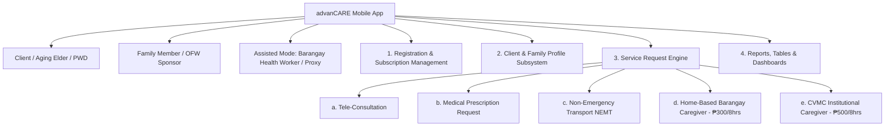
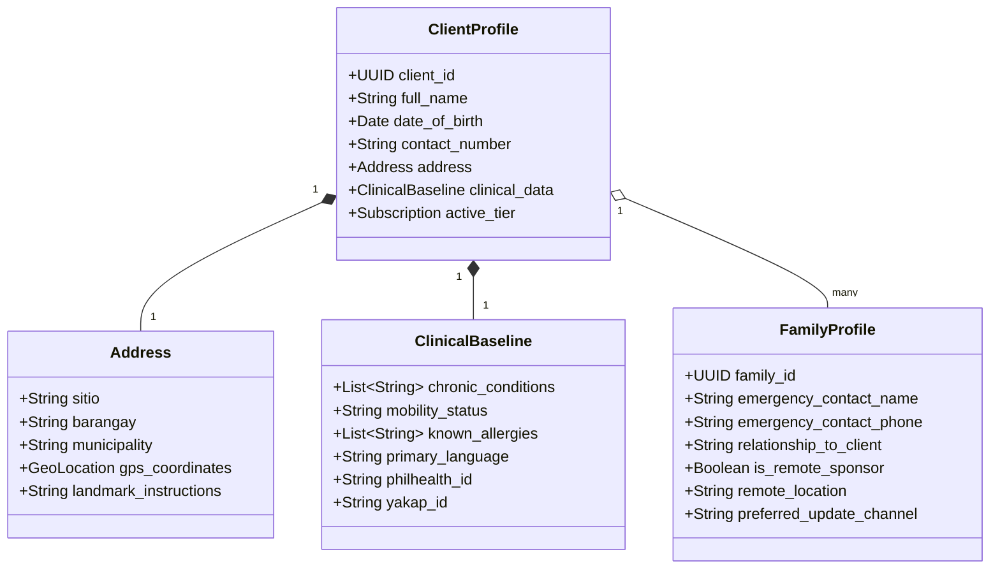
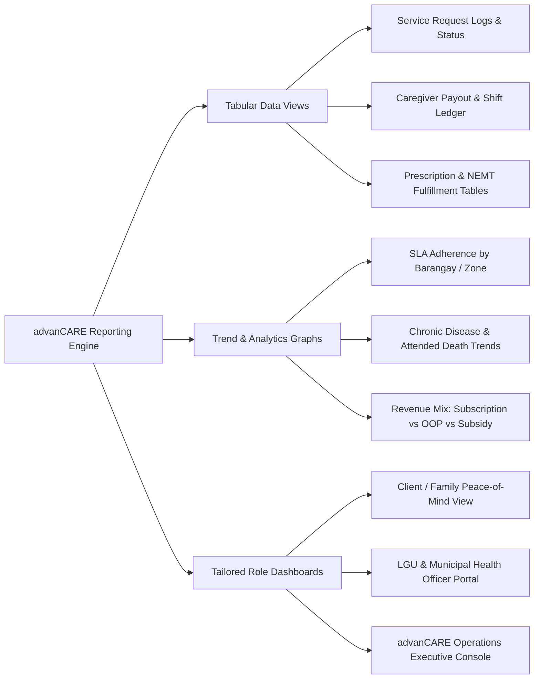

# advanCARE Mobile App System Specification

> **Platform:** advanCARE Grassroots Mobile App (Cross-Platform PWA / Android / iOS)  
> **Target Audience:** Barangay Residents, Aging Farmers & Fishers, Persons with Special Needs (PWD), Family Members / OFW Sponsors, and Barangay Health Workers (BHWs).  
> **Core Architectural Principle:** Low-bandwidth optimization, offline-first sync, multilingual support (Ilocano, Ybanag, Tagalog, English), and seamless Agentic AI (n8n) webhook integration.

---

## 1. System Architecture & User Roles

---

## 2. Module 1: Registration & Subscription Management

Enables grassroots clients, assisted family members, or BHWs to enroll individuals into the advanCARE ecosystem and select an affordable membership tier.

### 1. Registration Flow
- **Authentication:** Mobile phone number with SMS OTP verification (supports simple feature-phone SMS proxy registration by BHWs).
- **Identity Capture:** Name, Date of Birth, Gender, Civil Status, PhilHealth ID (optional), DoH Yakap ID (optional), Senior Citizen ID, or PWD ID.
- **Assisted Registration Switch:** Option for "Registering for a Parent/Dependent" (activates remote sponsor billing and notifications).

### 2. Tier Selection & Subscription Model
Anchored below the statutory PhilHealth minimum floor (₱500/mo or ₱6,000/yr) through a **50% LGU Subsidy + 50% Household Out-of-Pocket** mechanism:

| Tier | Total Cost | Household OOP (50%) | LGU Subsidy (50%) | SLA Response Time | Key Inclusions |
| :--- | :--- | :--- | :--- | :--- | :--- |
| **Platinum** | ₱4,200/yr (₱350/mo) | ₱2,100/yr (₱175/mo) | ₱2,100/yr (₱175/mo) | **1 hr** (Town/City) **3 hrs** (Rural Sitio) | Unlimited Tele-Consult triage, priority NEMT booking, priority CVMC caregiver dispatch, weekly family health check. |
| **Gold** | ₱3,000/yr (₱250/mo) | ₱1,500/yr (₱125/mo) | ₱1,500/yr (₱125/mo) | **2 hrs** (Town/City) **3 hrs** (Rural Sitio) | Tele-Consult triage, standard NEMT booking, scheduled home caregiver matching, bi-weekly health updates. |
| **Silver** | ₱1,800/yr (₱150/mo) | ₱900/yr (₱75/mo) | ₱900/yr (₱75/mo) | **24–48 hrs** (Scheduled Care Only) | Tailored for 4Ps / Indigent families. Scheduled home wellness visits, prescription routing, no on-demand emergency routing. |

### 3. Payment Methods
- **Digital:** GCash, Maya, Bank Transfer.
- **Cash Ledger:** Barangay Hall / BHW collection with digital receipting via the app.
- **Diaspora / OFW Billing:** Credit/Debit card processing for family members living outside Cagayan or abroad.

---

## 3. Module 2: Client Profile & Family Profile Subsystem

Maintains a comprehensive, reusable health and social record to eliminate duplicate intake and ensure continuity of care.

### Profile Data Fields:
1. **Client Identity:** Full legal name, nickname/alias, gender, contact number, emergency contact.
2. **Granular Rural Address:** 
   - Municipality (e.g., Tuguegarao, Solana, Baggao, Aparri).
   - Barangay (e.g., Centro, Pengue-Ruyu, Caritan).
   - Sitio / Purok.
   - GPS Pin & Local Landmarks (e.g., "Adjacent to Purok 3 Mango Tree, blue gate").
3. **Clinical & Functional Baseline:**
   - Primary chronic conditions (Hypertension, Diabetes Type 2, Post-Stroke, Osteoarthritis, Dementia).
   - Mobility level (Independent, Uses Cane/Walker, Wheelchair-bound, Bedridden).
   - Sensory status (Vision impaired, Hearing impaired, Speech impaired).
   - Dietary restrictions & Drug allergies.
4. **Family Circle & Diaspora Profile:**
   - Co-resident primary caregiver (e.g., spouse or daughter).
   - Emergency contacts with designated priority order.
   - Remote / OFW Family Member details: Name, relationship, country/city of residence, phone/WhatsApp number, opt-in for automated digital care notes.

---

## 4. Module 3: Client Service Request Subsystems

The core transaction engine of the advanCARE mobile app, supporting five specialized service requests:

### a) Tele-Consultation Subsystem
- **Purpose:** Connect rural clients with licensed remote doctors and triage nurses to diagnose conditions, review symptoms, and prevent unattended deaths.
- **Workflow:**
  1. Client or BHW selects "Request Tele-Consult".
  2. Input chief complaint (e.g., fever, chest pain, uncontrolled blood pressure, wound redness) via voice memo, text, or guided symptom checklist.
  3. Upload photo of symptom/wound/vitals reading.
  4. Agentic AI (n8n) triage evaluates acuity:
     - **Red (Critical):** Immediate alert to 911/MDRRMO ambulance dispatch.
     - **Yellow (Urgent):** Routes to on-duty Tele-Nurse within 15–30 mins.
     - **Green (Routine):** Schedules video/audio consultation slot with partner physician.
  5. Post-consultation: Doctor submits digital clinical soap note and electronic prescription directly into the client record.

### b) Request Medical Prescription Subsystem
- **Purpose:** Seamless prescription fulfillment, maintenance refills, and pharmacy liaison.
- **Workflow:**
  1. User selects "Request Prescription".
  2. Options:
     - *Refill Existing Prescription:* Selects from verified active medication list in Client Profile.
     - *Upload New Prescription:* Snaps photo of physical prescription from RHU or private clinic.
  3. Formulation & Procurement Check:
     - Automatically verifies availability under **DoH Yakap** free essential drugs program.
     - If covered by Yakap: Coordinates with BHW for pickup at Rural Health Unit (RHU).
     - If non-Yakap (e.g., specialized cardiovascular drugs, vitamins, supplements): Calculates discounted pooled pharmacy procurement price.
  4. Delivery Options: Pickup at Barangay Health Center or delivery to home via advanCARE transport pool.

### c) Non-Emergency Medical Transport (NEMT) Subsystem
- **Purpose:** Eliminate the primary physical barrier to healthcare in Cagayan by scheduling structured, safe transit for dialysis, chemotherapy, prenatal care, or clinical checkups.
- **Input Parameters:**
  - **Pickup Time & Date:** Scheduled appointment time.
  - **Source:** Exact sitio/barangay location (auto-filled from profile).
  - **Destination:** Medical facility (e.g., Cagayan Valley Medical Center [CVMC], Solana RHU, Tuguegarao City People's General Hospital).
  - **Mobility / Vehicle Requirement:** Standard tricycle/multicab, wheelchair-accessible vehicle, or non-emergency stretcher transport.
  - **Medical Escort Add-On:** Option to bundle a trained youth/barangay caregiver to accompany the patient through clinic lines and pharmacy queues.
- **Status Tracking:** Live route updates, driver contact, and estimated arrival notification.

### d) Request Home-Based Caregiver in Barangay (₱300 for 8 Hours)
- **Purpose:** Affordable, community-led home care for daily living activities, caregiver respite, and chronic care support.
- **Pricing:** **₱300 for an 8-hour shift** (Community Barangay Rate).
- **Scope of Service:**
  - Assistance with bathing, grooming, toileting, and linen change.
  - Vital signs monitoring (BP, heart rate, temperature, blood sugar).
  - Meal preparation and feeding assistance.
  - Fall prevention, physical mobility, and range-of-motion exercises.
  - Respite care allowing family farmers/fishers to attend to field or fishing labor without anxiety.
- **Matching:** n8n Agentic matching assigns an accredited local barangay youth caregiver within the same or neighboring barangay to avoid travel delays.

### e) Request for CVMC Institutional Caregiver (₱500 for 8 Hours)
- **Purpose:** Dedicated hospital bedside care ("Hospital Watcher / Companion") at **Cagayan Valley Medical Center (CVMC)** in Tuguegarao City.
- **Context:** In Philippine public tertiary hospitals, nurses manage dozens of patients; families are required to provide a bedside "watcher" 24/7 to monitor IV lines, assist with bedpans, purchase stat meds, and notify nurses. Rural families often cannot afford to leave their farm or children for days to stay at CVMC.
- **Pricing:** **₱500 for an 8-hour shift** (Institutional Hospital Rate).
- **Scope of Service:**
  - Continuous bedside vigilance in CVMC wards.
  - Assistance with repositioning, bed baths, and hygiene.
  - Pharmacy and diagnostic errand running within CVMC.
  - Monitoring patient alert status and notifying ward nurses of any deterioration.
  - Shift summary and clinical progress report sent to family via the app.

---

## 5. Module 4: Reporting & Analytics Subsystem

Provides multi-dimensional reporting via tables, interactive graphs, and comprehensive dashboards:

### 1. Tabular Reports
- **Request Ledger:** Filterable by date, barangay, service type (Teleconsult, Rx, NEMT, Bgay Caregiver, CVMC Caregiver), status (Pending, Dispatched, In-Progress, Completed, Escalated), and assigned caregiver.
- **Caregiver Shift & Payout Table:** Shift duration, client name, hourly/shift payout (₱300 or ₱500), platform fee, transport reimbursement, and net payout.
- **LGU Household Registry:** List of registered households under 50% subsidy, tier status, total visits rendered, and remaining municipal allocation.

### 2. Graphical Visualizations
- **SLA Response Time Trends (Line Graph):** Tracking response time in major towns (target 1–2 hrs) vs remote rural sitios (target 3 hrs).
- **Service Utilization Breakdown (Donut Chart):** Distribution of requests across Tele-Consult, NEMT, Home Caregiver, CVMC Caregiver, and Prescriptions.
- **Health Outcome & Attendance Metrics (Bar Graph):** Ratio of medically attended health episodes vs baseline unattended deaths (targeting reduction in the 56.3% PSA statistic).

### 3. Dedicated Dashboards
- **Family Dashboard:** Displays live shift status, latest vitals log, caregiver profile, and past visit history.
- **Municipal LGU Dashboard:** Displays barangay coverage percentages, indigent subsidy utilization, and public health impact indicators.
- **Executive Operations Console:** Tracks real-time caregiver supply pools, unassigned requests, active NEMT trips, and system revenue.
