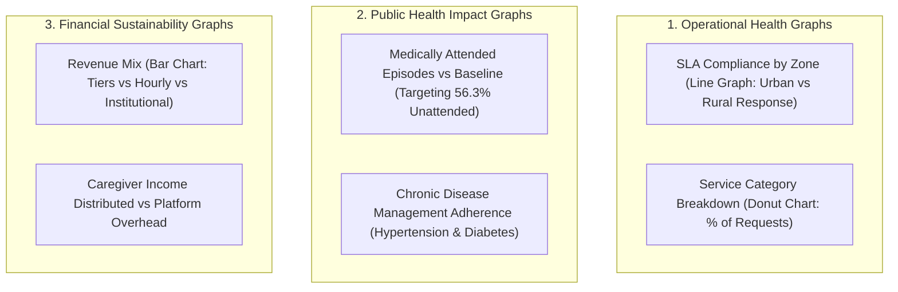

# advanCARE Reporting Engine: Tables, Graphs, & Dashboard Specifications

> **System:** Operational, Clinical, & Financial Analytics Subsystem  
> **Audience:** Family Members & OFW Sponsors, Barangay Health Workers (BHWs), Municipal Local Government Units (LGUs), and advanCARE Operations Executives.  
> **Technical Stack:** PostgreSQL Views, Retool/Appsmith Admin Panels, Metabase/Superset Dashboards, and n8n Automated PDF/CSV Digest Generators.

---

## 1. Tabular Reporting Specifications

The system generates five core real-time tabular reports accessible via web, mobile admin, and automated weekly email/PDF exports.

### Table 1: Service Request Master Ledger
Tracks every incoming grassroots service request from intake through completion.

| Column Name | Data Type | Description | Sample Value |
| :--- | :--- | :--- | :--- |
| `request_id` | String | Unique alpha-numeric identifier | `REQ-2026-0419` |
| `timestamp` | DateTime | Intake time via App or SMS | `2026-10-15 08:30:00` |
| `client_name` | String | Patient full name | `Juan Dela Cruz` |
| `sitio_barangay`| String | Granular rural location | `Sitio Riverside, Brgy. Caritan` |
| `service_type` | Enum | Specific requested service | `Bgay Caregiver (₱300/8hr)` |
| `sla_deadline` | DateTime | Target response cutoff time | `2026-10-15 11:30:00 (Gold 3hr)` |
| `assigned_to` | String | Assigned caregiver or driver | `Maria Santos (Youth Care Pro)` |
| `status` | Enum | Request lifecycle state | `In-Progress` |
| `client_rating`| Float | Post-service family rating (1-5) | `5.0 ★` |

### Table 2: Caregiver Shift & Payout Ledger
Maintains transparent, auditable records of all caregiver shifts, earnings, and platform fees.

| Column Name | Data Type | Description | Sample Value |
| :--- | :--- | :--- | :--- |
| `shift_id` | String | Unique shift reference | `SFT-8832` |
| `caregiver_name`| String | Accredited Care Pro | `Reynaldo Ramos` |
| `service_tier` | String | Type of shift completed | `CVMC Institutional (₱500/8hr)` |
| `facility_location`| String | Home address or hospital ward | `CVMC Ward 3, Bed 14` |
| `clock_in_time` | DateTime | Verified geofenced start time | `2026-10-15 07:00:00` |
| `clock_out_time`| DateTime | Verified end time | `2026-10-15 15:00:00` |
| `gross_billing` | Currency | Total client/tier charge | `₱500.00` |
| `caregiver_pay` | Currency | Net payout to caregiver (80%) | `₱400.00` |
| `platform_margin`| Currency | advanCARE coordination (20%) | `₱100.00` |
| `payout_status` | Enum | Payout disbursement state | `Paid via GCash` |

### Table 3: Non-Emergency Medical Transport (NEMT) Logistics Table
Tracks rural vehicle dispatch connecting remote barangays to healthcare centers and CVMC.

| Column Name | Data Type | Description | Sample Value |
| :--- | :--- | :--- | :--- |
| `trip_id` | String | Transportation request ID | `NEMT-1042` |
| `patient_name` | String | Transported individual | `Elena Tumbali` |
| `origin_sitio` | String | Remote pickup point | `Sitio Masoc, Solana` |
| `dest_facility` | String | Target clinic or hospital | `Cagayan Valley Medical Center` |
| `vehicle_type` | Enum | Vehicle category | `Wheelchair-Accessible Multicab`|
| `pickup_time` | DateTime | Scheduled departure | `2026-10-15 06:30:00` |
| `escort_assigned`| String | Youth Caregiver accompanying | `Ana Balisi (Medical Escort)` |
| `trip_status` | Enum | Live transit status | `Completed / Safely Returned` |

### Table 4: LGU Subsidy Reconciliation & Household Registry
Delivered quarterly to Municipal Mayors and Local Health Boards for 50/50 cost-share auditing.

| Barangay | Enrolled Households | Active Tier Mix (Plat / Gold / Silver) | Total Monthly Billed (100%) | 50% LGU Subsidy Due | 50% Household OOP Collected | Active SLA Adherence |
| :--- | :--- | :--- | :--- | :--- | :--- | :--- |
| **Brgy. Caritan Centro** | 45 | 10 Plat / 20 Gold / 15 Silver | ₱12,750 / mo | ₱6,375.00 | ₱6,375.00 | 96.4% |
| **Brgy. Cataggaman** | 60 | 5 Plat / 35 Gold / 20 Silver | ₱15,000 / mo | ₱7,500.00 | ₱7,500.00 | 93.8% |
| **Sitio Masoc (Remote)** | 30 | 0 Plat / 10 Gold / 20 Silver | ₱6,500 / mo | ₱3,250.00 | ₱3,250.00 | 91.2% |

---

## 2. Graphical Analytics Specifications

### Graph 1: Service Utilization Breakdown (Donut Chart)
- **Visual:** Proportional distribution of monthly volume across the 5 request types.
- **Data Series:**
  - Home-Based Barangay Caregiver (₱300/8hr): ~45%
  - CVMC Institutional Caregiver (₱500/8hr): ~25%
  - Non-Emergency Medical Transport (NEMT): ~15%
  - Tele-Consultation Triage: ~10%
  - Medical Prescription Refill: ~5%

### Graph 2: SLA Response Time Trends (Dual Line Chart)
- **X-Axis:** Weeks / Months.
- **Y-Axis:** Response time in minutes.
- **Series 1 (Urban Town):** Target <60 mins (Platinum), actual moving average.
- **Series 2 (Remote Rural Sitio):** Target <180 mins (Gold/Platinum), actual moving average.

### Graph 3: Medically Attended Health Episodes vs. Baseline (Impact Bar Chart)
- **Benchmark:** PSA 2020 Cagayan Baseline = **56.3% Unattended Deaths**.
- **advanCARE Impact Metric:** % of reported acute episodes receiving formal clinical attendance, teleconsultation, or hospital watcher handoff (Target: >85% attended).

---

## 3. Dedicated Role Dashboards

### 1. Family & Remote OFW Sponsor Dashboard (Mobile App)
- **Hero Card:** Status of elderly parent (e.g., *"Tatay Juan is currently resting. Care Pro Maria Santos is on duty at home until 3:00 PM."*)
- **Quick Actions:** [Request Tele-Consult] [Book NEMT] [Renew Prescription] [Top-Up Care Hours].
- **Live Vitals Feed:** BP (125/82), Blood Glucose (110 mg/dL), Temperature (36.6°C).
- **Recent Care Notes:** Daily checklist with photo verification.

### 2. Municipal LGU & Rural Health Unit (RHU) Portal (Web)
- **Municipal Overview:** Total beneficiaries supported, indigent 4Ps household coverage map.
- **Public Health Indicators:** Number of attended chronic patient checkups, subsidized transport trips to RHU/CVMC.
- **Subsidy Ledger:** Total LGU 50% matching investment vs. verified healthcare services delivered.

### 3. advanCARE Operations Command Center (Internal)
- **Live Dispatch Map:** Real-time pins showing active caregiver shifts in barangays and CVMC wards.
- **Pending Matching Queue:** Automated n8n intake requests pending caregiver confirmation.
- **Caregiver Capacity Barometer:** Available vs. dispatched youth and community caregivers by barangay.
