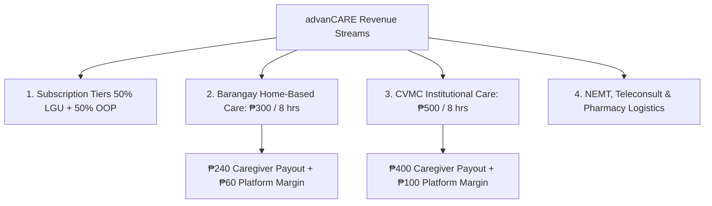
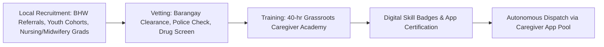

# advanCARE Service Catalog & Caregiver Operations

> **Document:** Standard Operating Procedures (SOP), Unit Economics, & Caregiver Protocols  
> **Key Services:** Barangay Home-Based Caregiver (₱300/8hrs) & CVMC Institutional Caregiver (₱500/8hrs)  
> **Operational Context:** Cagayan Province Grassroots Health Ecosystem

---

## 1. Service Catalog & Unit Economic Breakdown

To maintain financial self-sustainability without depending on perpetual charity, advanCARE enforces transparent, published pricing with structured platform margins that cover coordination, insurance, tech infrastructure, and transport pooling.

### Detailed Pricing & Revenue Split Matrix:

| Service Offering | Published Rate | Target Shift Duration | Caregiver Payout | advanCARE Coordination Margin | Target SLA | Primary Use Case |
| :--- | :--- | :--- | :--- | :--- | :--- | :--- |
| **Home-Based Barangay Caregiver** | **₱300** | 8 Hours | ₱240 (80%) | ₱60 (20%) | Platinum: 1–3 hrs Gold: 2–3 hrs Silver: 24–48 hrs | Daily living assistance (ADL), vital monitoring, respite for farming/fishing families. |
| **CVMC Institutional Caregiver** | **₱500** | 8 Hours | ₱400 (80%) | ₱100 (20%) | On-Demand (2 hrs) or Scheduled | Dedicated hospital bedside companion/watcher at Cagayan Valley Medical Center. |
| **Tele-Consultation Triage** | ₱100 (Free for Plat/Gold) | 15–20 Mins | ₱70 (Clinician) | ₱30 (Platform) | 15–30 Mins (Triage) | Remote physician evaluation, diagnosis, electronic prescription issuance. |
| **Non-Emergency Transport (NEMT)** | ₱150 – ₱350 (Distance-based) | Per Trip | 80% (Driver pool) | 20% (Logistics pool) | Pre-scheduled | Safe transport from rural sitio to Rural Health Unit (RHU) or CVMC. |
| **Prescription Fulfillment** | Free via Yakap (₱50 delivery flat) | Per Order | ₱35 (Courier/BHW) | ₱15 (Platform) | Within 24 hrs | Delivery of maintenance meds and pooled non-Yakap supplements. |

---

## 2. Cagayan Valley Medical Center (CVMC) Caregiver Protocol

### Background & Hospital Context
**Cagayan Valley Medical Center (CVMC)** in Carig Sur, Tuguegarao City is the premier tertiary level III government hospital serving Region II (Cagayan Valley). Due to severe nurse-to-patient ratios in public wards, Philippine public hospital protocol mandates that **each admitted patient must have an active bedside companion ("watcher")** to:
1. Assist the patient with bedpans, hygiene, and turning to prevent pressure ulcers.
2. Monitor IV infusion drip levels and immediately flag nurses when bags are empty or infiltrated.
3. Physically run to the hospital pharmacy or outpatient diagnostic laboratories for stat laboratory specimens, blood bags, and prescribed medicines.
4. Provide emotional comfort, feeding, and physical security.

### The Rural Family Dilemma
For rural farming and fishing families in Solana, Peñablanca, Alcala, or Baggao, having an elder hospitalized at CVMC often means **pulling an adult out of livelihood labor for weeks**, forfeiting agricultural income, and incurring expensive food, transportation, and lodging costs in Tuguegarao.

### advanCARE CVMC Caregiver Operational Protocol:
1. **Accredited Dispatch:** Only caregivers badged with the **"Hospital Watcher Competency"** are dispatched to CVMC wards.
2. **Bedside Shift Handoff:**
   - Caregiver reports to CVMC ward nurse on duty, presents digital advanCARE identification, and logs arrival via the app.
   - Caregiver receives vital status, fluid limits, and doctor's orders.
3. **Core Shift Tasks (8 Hours):**
   - Assisting patient with hydration, prescribed meal intake, and oral medication ingestion.
   - Bed-bathing and repositioning every 2 hours.
   - Running authorized laboratory and pharmacy errands within CVMC premises.
   - Immediate notification of ward nurses if patient develops fever, respiratory distress, pain spikes, or disorientation.
4. **Shift Conclusion & Reporting:**
   - Caregiver inputs digital shift summary in the advanCARE app (meals consumed, fluids, urine output, medications taken, doctor visits).
   - Summary is immediately broadcast to the client's family profile and long-distance OFW sponsor.

---

## 3. Barangay Home-Based Caregiver Protocol (₱300 for 8 Hours)

### Operational Principles:
- **Hyper-Local Assignment:** Caregivers are matched strictly within their home barangay or directly adjacent barangay to eliminate travel costs.
- **Intergenerational Engagement:** Youth caregivers bridge the generational gap, providing tech assistance, companionship, and learning indigenous agricultural wisdom from elders while earning dignified local income.

### Core Care Package Checklist:
1. **Morning Vital Signs Intake:** Blood pressure, pulse rate, respiration, body temperature. Recorded directly into mobile app or offline paper log.
2. **Personal Hygiene:** Assisted sponge bath/shower, hair combing, oral care, clean clothing change.
3. **Nutrition & Hydration:** Warming/preparing meals, ensuring adequate water intake, monitoring diabetic or low-sodium dietary restrictions.
4. **Medication Management:** Reminding client of prescribed times, checking blister packs against the active prescription profile.
5. **Mobility & Fall Prevention:** Guided walking, light stretching, clearing floor obstacles, transfer assistance from bed to chair.
6. **Respite for Household:** Allowing family members to farm, fish, or manage home enterprise without constant caregiving anxiety.

---

## 4. Caregiver Recruitment, Vetting, & Skill Badges

### Digital Skill Badges:
1. **Badge A: Core Personal Care (ADL):** Hygiene, transferring, vitals measurement, nutrition. (Mandatory for all ₱300/8hr home shifts).
2. **Badge B: Dementia & Memory Care:** De-escalation of agitation, wandering management, cognitive memory games.
3. **Badge C: CVMC Hospital Watcher:** Tertiary hospital protocols, IV observation, sterile errand handling. (Mandatory for ₱500/8hr CVMC shifts).
4. **Badge D: Post-Discharge & Wound Care Assist:** Surgical site observation, clean dressing assist under tele-nurse supervision.
