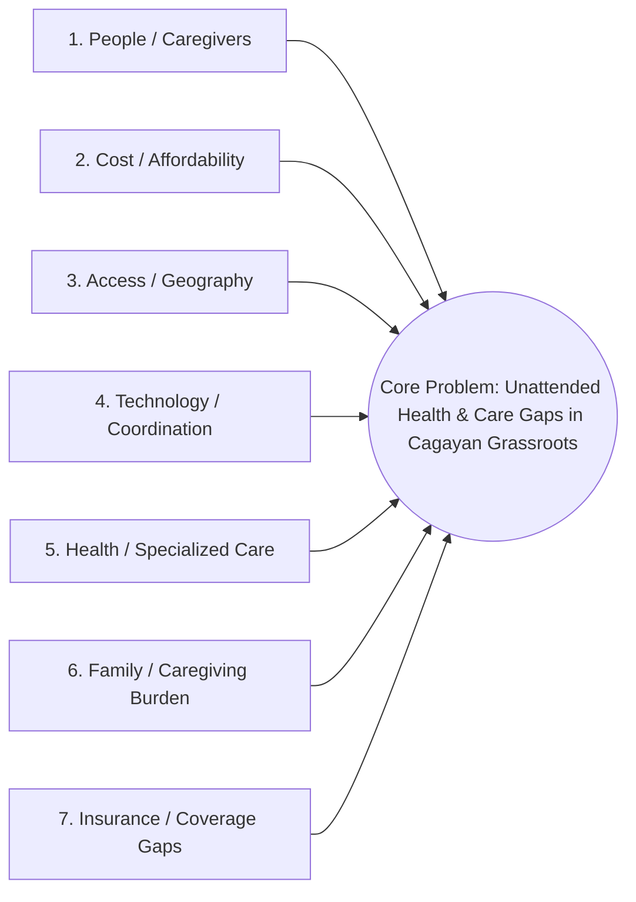

# Fishbone Root Cause Analysis & Solution Mapping

> **Visual Artifact:** [[Fishbone Diagram.jpeg]]  
> **Core Problem Statement:** Aging farmers, fishers, and families of persons with special needs in Cagayan struggle to access affordable, reliable, and continuous care and wellness support.  
> **Methodology:** Ishikawa 7-Spine Root Cause Decomposition mapped 1:1 to global benchmarks and advanCARE platform solutions.

---

## 1. Visual Overview & The 7 Root Cause Spines

---

## 2. Granular 1:1 Spine Decomposition & Resolution Matrix

### Spine 1: People / Caregivers
- **Observed Failures in Cagayan:** Severe shortage of trusted, screened local caregivers; haphazard informal hiring through word-of-mouth; mismatched caregiver skill vs. senior acuity; high caregiver burnout and attrition.
- **Global Benchmark Solution (Honor & Homage):**
  - Homage's strict <5% vetting funnel and digital skill badging.
  - Honor's workforce retention model: transparent shift pay and scheduling autonomy cutting turnover from 80% to 30%.
- **advanCARE Platform Execution:**
  - Youth & community caregiver cohort recruitment paired with Barangay Health Workers (BHWs).
  - Digital accreditation badges: `BADGE_ADL`, `BADGE_DEMENTIA`, `BADGE_CVMC_WATCHER`.
  - Guaranteed local shifts at ₱300/8hr (Home) and ₱500/8hr (CVMC) with 80% net payout to the worker.

### Spine 2: Cost / Affordability
- **Observed Failures in Cagayan:** Commercial in-home nurses cost ₱1,500–₱2,500/day, totally out of reach for farming/fishing families (31.6% farmer poverty rate); opaque pricing leads to catastrophic out-of-pocket expenses.
- **Global Benchmark Solution (Auxilio Care & Centene):**
  - Auxilio's public-private co-pay framework (Local Council grant + client top-up).
  - Centene's capitated PMPM financing.
- **advanCARE Platform Execution:**
  - Anchored strictly below the PhilHealth minimum floor (₱500/mo or ₱6,000/yr).
  - 50/50 LGU Subsidy: Platinum (₱175/mo OOP), Gold (₱125/mo OOP), Silver (₱75/mo OOP for 4Ps indigent families).
  - Transparent flat fees: ₱300 for 8-hr Barangay Home Care; ₱500 for 8-hr CVMC Hospital Care.

### Spine 3: Access / Geography
- **Observed Failures in Cagayan:** Health services concentrated in Tuguegarao and poblacion town centers; remote sitios cut off by rough roads, rivers, and expensive unorganized transport.
- **Global Benchmark Solution (Centene):**
  - Formalizing **Non-Emergency Medical Transportation (NEMT)** as a clinical risk-mitigation tool to prevent missed dialysis, chemo, and acute flare-ups.
- **advanCARE Platform Execution:**
  - Integrated NEMT subsystem in the Mobile App: pre-scheduled pickup times, origin sitio, destination clinic/CVMC, with accessible vehicle dispatch.
  - Hyper-local caregiver dispatch clustering within the same barangay to eliminate transit friction.

### Spine 4: Technology / Coordination
- **Observed Failures in Cagayan:** Zero digital health infrastructure; fragmented intake on paper or loose SMS; no shared care records between families, BHWs, and clinics; lost medical histories.
- **Global Benchmark Solution (Honor):**
  - Centralized cloud platform handling matching, geofencing, care notes, and invoicing.
- **advanCARE Platform Execution:**
  - Unified **advanCARE Mobile App** (PWA/Android/iOS) with low-bandwidth offline caching.
  - **Agentic AI by n8n** running automated intake, algorithmic matching, dispatch, and reporting.

### Spine 5: Health / Specialized Care
- **Observed Failures in Cagayan:** No continuity of care post-hospital discharge; zero out-of-hospital triage; untreated dementia and chronic hypertension/diabetes leading to strokes (56.3% PSA unattended death baseline).
- **Global Benchmark Solution (Homage & Auxilio Care):**
  - Homage's specialized condition protocols (dementia, stroke, post-surgical recovery).
  - Auxilio's person-centered complex care plans for persons with disabilities (PWD).
- **advanCARE Platform Execution:**
  - On-demand **Tele-Consultation** with triage decision trees to catch deterioration early.
  - Structured 48-hour post-discharge follow-up visits bundled with CVMC hospital transitions.

### Spine 6: Family / Caregiving Burden
- **Observed Failures in Cagayan:** Working-age adults forced to abandon farm fields, fishing boats, or jobs to provide 24/7 care or stay as hospital watchers at CVMC; long-distance OFW children stressed by lack of visibility.
- **Global Benchmark Solution (Homage & Honor):**
  - Digital Family App providing daily care logs, photo verification, and transparent vitals.
- **advanCARE Platform Execution:**
  - **CVMC Institutional Caregiver (₱500/8hrs):** Relieves family members from hospital watcher duty so they can maintain agricultural livelihoods.
  - **Family Circle & OFW Portal:** Sends automated natural-language SMS/WhatsApp care summaries to diaspora sponsors abroad.

### Spine 7: Insurance / Service Coverage Gaps
- **Observed Failures in Cagayan:** PhilHealth does not cover non-emergency transit; DoH Yakap does not cover specialized drugs, supplements, or bedside care; out-of-hospital care has no coverage.
- **Global Benchmark Solution (Centene & Auxilio Care):**
  - Multi-payer blending to bridge statutory gaps.
- **advanCARE Platform Execution:**
  - advanCARE acts as the grassroots bridge: coordinates free DoH Yakap medicines through RHUs, pools procurement discounts for non-Yakap supplements, and integrates NEMT directly into ecosystem memberships.
