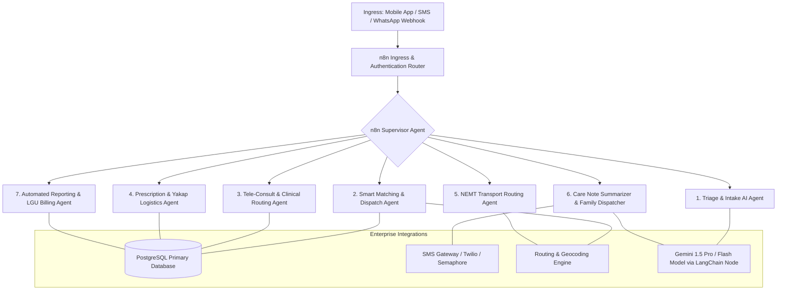
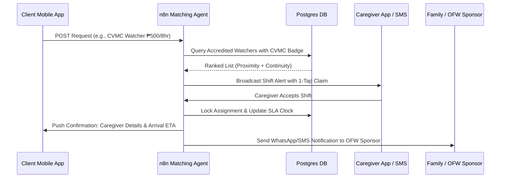
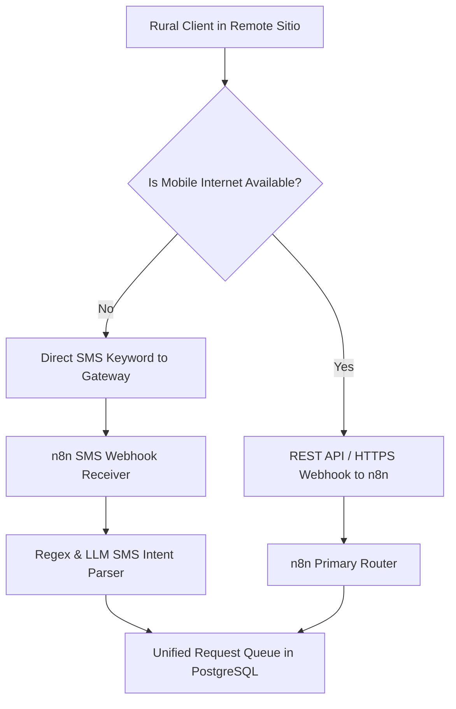

# advanCARE Agentic AI & n8n Workflow Architecture

> **Orchestrator:** n8n Workflow Automation Engine (Self-Hosted / Cloud)  
> **Architecture:** Event-Driven Multi-Agent System (MAS) with LLM Tool-Calling & Human-in-the-Loop Safeguards  
> **Trigger Channels:** Mobile App Webhooks, SMS Gateway (Twilio/Semaphore), and WhatsApp/Viber API  
> **Languages Handled:** Ilocano, Ybanag, Tagalog, and English

---

## 1. System Overview & Multi-Agent Architecture

The advanCARE backend leverages **Agentic AI orchestrated through n8n workflows** to eliminate manual operational overhead, automate caregiver dispatch, route clinical triage, coordinate transportation, and deliver real-time family updates.

---

## 2. Specialized Agent Workflows in n8n

### Workflow 1: Triage & Intake AI Agent
- **Trigger:** Webhook `POST /api/v1/requests/intake` (from Mobile App or SMS text parser).
- **Core LLM Node:** Gemini 1.5 Flash structured tool calling.
- **Role:** 
  1. Ingests free-text, voice transcription, or form inputs in English, Tagalog, Ilocano, or Ybanag.
  2. Extracts structured entities: `client_id`, `service_category` (Teleconsult, Rx, NEMT, Bgay Care, CVMC Care), `urgency_level` (Red, Yellow, Green), `preferred_time`, `symptoms`, `special_requirements`.
  3. Safety Filter: If Red (acute emergency like severe chest pain, stroke signs, unresponsive elder), triggers immediate SMS/Call webhook to municipal emergency services (MDRRMO/911) and alerts family.
  4. Stores sanitized request record into PostgreSQL `service_requests` table with status `QUEUED_FOR_MATCHING`.

### Workflow 2: Smart Proximity Dispatch & Matching Agent (Honor-Inspired)
- **Trigger:** Event `service_request.created` (Type: `BGAY_CARE` or `CVMC_CARE`).
- **Logic:**
  1. Queries PostgreSQL for active caregivers with valid credentials and the required badge (`BADGE_ADL` for ₱300/8hr home care; `BADGE_CVMC_WATCHER` for ₱500/8hr hospital care).
  2. Filters by proximity: Caregiver address matches client's barangay or adjacent cluster (Haversine distance < 3 km for rural, or Tuguegarao-based for CVMC).
  3. Checks continuity score: Prioritizes caregivers who previously received 4.5+ ratings from this specific household.
  4. Dispatches push notification and SMS to the top 3 ranked caregivers.
  5. First caregiver to accept is locked into shift; SLA timer stops.
  6. **Fallback Escalation:** If no caregiver accepts within 20 minutes (Platinum) or 45 minutes (Gold), auto-escalates to the advanCARE Human Coordinator on-call.

### Workflow 3: Tele-Consult & Clinical Routing Agent
- **Trigger:** Event `service_request.created` (Type: `TELECONSULT`).
- **Logic:**
  1. Checks physician / tele-nurse availability calendar.
  2. Assembles patient clinical baseline: chronic diseases, recent vitals, known allergies, active medications from `client_profiles`.
  3. Creates secure video room link (e.g., Jitsi/Daily.co) or audio conference bridge.
  4. Sends SMS reminder to patient and doctor 10 minutes prior to session.
  5. Ingests physician's post-consult clinical soap note; if new prescriptions are ordered, automatically creates a linked `RX_REQUEST`.

### Workflow 4: Prescription & Yakap Logistics Agent
- **Trigger:** Event `service_request.created` (Type: `PRESCRIPTION`).
- **Logic:**
  1. Cross-checks requested medicines against the **DoH Yakap Essential Medicine List** (anti-hypertensives, metformin, maintenance statins).
  2. **Yakap Branch:** If available for free at the Rural Health Unit (RHU), generates a pharmacy pickup voucher and routes task to local BHW.
  3. **Non-Yakap Branch:** If medicine requires out-of-pocket purchase (specialized cardio drugs, wound dressings, vitamins), pulls pooled wholesale pricing from partner Tuguegarao distributor, generates GCash payment link, and routes to delivery courier.
  4. Emits delivery confirmation to patient and family upon drop-off.

### Workflow 5: Non-Emergency Medical Transport (NEMT) Logistics Agent
- **Trigger:** Event `service_request.created` (Type: `NEMT`).
- **Logic:**
  1. Parses origin sitio, destination facility (e.g., CVMC or RHU), and scheduled medical appointment time.
  2. Determines vehicle requirement: Standard Tricycle, Accessible Multicab, or Stretcher Van.
  3. Computes pickup time factoring in rural unpaved road transit times.
  4. Assigns vetted community transport driver and pairs with a Youth Medical Escort (if requested).
  5. Coordinates round-trip return journey once clinic consultation is completed.

### Workflow 6: Care Note Summarizer & Family Dispatcher (Homage-Inspired)
- **Trigger:** Caregiver taps "Complete Shift" and submits raw visit checklist (vitals, food, hygiene, activities).
- **Core LLM Node:** Gemini 1.5 Flash prompt:
  - *Context:* Translates clinical vitals and activities into warm, clear, empathetic prose.
  - *Languages:* Generates update in family sponsor's selected language (e.g., English for abroad, Tagalog or Ilocano for domestic).
- **Output Action:**
  1. Saves formatted note into `care_notes` table.
  2. Sends real-time notification to the Mobile App.
  3. Sends SMS or WhatsApp digest to remote OFW family sponsor (e.g., *"AdvanCare Update: Tatay Juan completed his 8-hr care with Care Pro Maria. Blood pressure stable at 125/80, ate lunch well, and completed his afternoon mobility walk safely."*)

### Workflow 7: Automated Reporting & LGU Billing Agent
- **Trigger:** Cron schedule (Daily at 23:00 and Monthly on the 1st).
- **Logic:**
  1. Aggregates daily shift logs, SLA response adherence, and completed visits by barangay.
  2. Computes 50% LGU subsidy liability vs. 50% household collections.
  3. Generates HTML/PDF executive summary reports with embedded tables and SVG charts.
  4. Automatically emails quarterly billing packages to the Municipal Mayor, Municipal Health Officer (MHO), and Barangay Captains.

---

## 3. Resiliency, Low-Bandwidth, & Fallback Architecture

Given that connectivity in rural Cagayan sitios can be intermittent during typhoons and grid disruptions, n8n implements an **Offline & SMS Fallback Layer**:

1. **SMS Keyword Dispatch:** Clients or BHWs without smartphones can text structured keywords (e.g., `CARE 300`, `CARE CVMC`, `DOC`, `TRANS CVMC`) to a local virtual number.
2. **Offline Local Cache in Mobile App:** The mobile app caches client profiles, previous prescriptions, and emergency contacts offline using IndexedDB, syncing back to n8n when 4G/LTE reconnects.
3. **Dead-Letter Queue & Retries:** Every n8n webhook payload is logged to an append-only transaction ledger; failed notifications retry with exponential backoff and escalate to SMS if push notifications bounce.
