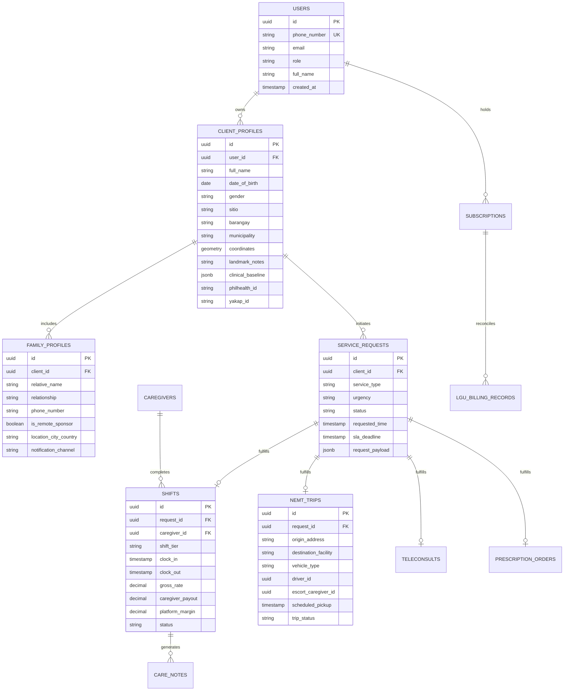

# advanCARE Data Models & Entity Schemas

> **Database:** PostgreSQL 16+ (with PostGIS for rural geocoding & routing)  
> **ORM / Access Layer:** Supabase / Prisma / Drizzle ORM  
> **Schema Purpose:** Power the advanCARE Mobile App, n8n Agentic Automation Workflows, and Tabular/Graphical Reporting Engine.

---

## 1. Entity-Relationship Diagram (ERD)



---

## 2. Core SQL Schema DDL

```sql
-- Enable UUID and PostGIS extensions
CREATE EXTENSION IF NOT EXISTS "uuid-ossp";
CREATE EXTENSION IF NOT EXISTS "postgis";

-- Enum Types
CREATE TYPE user_role AS ENUM ('CLIENT', 'FAMILY_SPONSOR', 'CAREGIVER', 'BHW_PROXY', 'DOCTOR', 'ADMIN');
CREATE TYPE subscription_tier AS ENUM ('PLATINUM', 'GOLD', 'SILVER', 'PAY_PER_USE');
CREATE TYPE service_category AS ENUM ('TELECONSULT', 'PRESCRIPTION', 'NEMT', 'BGAY_CARE', 'CVMC_CARE');
CREATE TYPE request_status AS ENUM ('PENDING', 'MATCHING', 'DISPATCHED', 'IN_PROGRESS', 'COMPLETED', 'CANCELLED', 'ESCALATED');
CREATE TYPE shift_tier_type AS ENUM ('BGAY_HOME_300', 'CVMC_INSTITUTIONAL_500');

-- 1. Users Table
CREATE TABLE users (
    id UUID PRIMARY KEY DEFAULT uuid_generate_v4(),
    phone_number VARCHAR(20) UNIQUE NOT NULL,
    email VARCHAR(255),
    role user_role NOT NULL DEFAULT 'CLIENT',
    full_name VARCHAR(255) NOT NULL,
    is_active BOOLEAN DEFAULT TRUE,
    created_at TIMESTAMPTZ DEFAULT NOW(),
    updated_at TIMESTAMPTZ DEFAULT NOW()
);

-- 2. Client Profiles
CREATE TABLE client_profiles (
    id UUID PRIMARY KEY DEFAULT uuid_generate_v4(),
    user_id UUID REFERENCES users(id) ON DELETE CASCADE,
    full_name VARCHAR(255) NOT NULL,
    date_of_birth DATE NOT NULL,
    gender VARCHAR(20),
    sitio VARCHAR(100) NOT NULL,
    barangay VARCHAR(100) NOT NULL,
    municipality VARCHAR(100) NOT NULL,
    gps_coordinates GEOMETRY(Point, 4326),
    landmark_notes TEXT,
    philhealth_id VARCHAR(50),
    yakap_id VARCHAR(50),
    pwd_id VARCHAR(50),
    senior_id VARCHAR(50),
    clinical_baseline JSONB DEFAULT '{
        "chronic_conditions": [],
        "mobility_status": "INDEPENDENT",
        "allergies": [],
        "dietary_restrictions": [],
        "primary_language": "ILOCANO"
    }'::jsonb,
    created_at TIMESTAMPTZ DEFAULT NOW(),
    updated_at TIMESTAMPTZ DEFAULT NOW()
);

-- 3. Family Profiles (including OFW/Remote Sponsors)
CREATE TABLE family_profiles (
    id UUID PRIMARY KEY DEFAULT uuid_generate_v4(),
    client_id UUID REFERENCES client_profiles(id) ON DELETE CASCADE,
    relative_name VARCHAR(255) NOT NULL,
    relationship VARCHAR(50) NOT NULL,
    phone_number VARCHAR(20) NOT NULL,
    is_emergency_contact BOOLEAN DEFAULT TRUE,
    is_remote_sponsor BOOLEAN DEFAULT FALSE,
    location_city_country VARCHAR(150),
    notification_channel VARCHAR(30) DEFAULT 'SMS',
    created_at TIMESTAMPTZ DEFAULT NOW()
);

-- 4. Subscriptions Table
CREATE TABLE subscriptions (
    id UUID PRIMARY KEY DEFAULT uuid_generate_v4(),
    client_id UUID REFERENCES client_profiles(id) ON DELETE CASCADE,
    tier subscription_tier NOT NULL DEFAULT 'SILVER',
    total_annual_cost NUMERIC(10, 2) NOT NULL,
    household_copay_monthly NUMERIC(10, 2) NOT NULL,
    lgu_subsidy_monthly NUMERIC(10, 2) NOT NULL,
    lgu_municipality VARCHAR(100) NOT NULL,
    status VARCHAR(30) DEFAULT 'ACTIVE',
    start_date DATE NOT NULL,
    renewal_date DATE NOT NULL,
    created_at TIMESTAMPTZ DEFAULT NOW()
);

-- 5. Service Requests Master Table
CREATE TABLE service_requests (
    id UUID PRIMARY KEY DEFAULT uuid_generate_v4(),
    client_id UUID REFERENCES client_profiles(id) ON DELETE CASCADE,
    service_type service_category NOT NULL,
    urgency VARCHAR(20) DEFAULT 'NORMAL',
    status request_status DEFAULT 'PENDING',
    requested_time TIMESTAMPTZ NOT NULL,
    sla_deadline TIMESTAMPTZ NOT NULL,
    request_payload JSONB NOT NULL DEFAULT '{}'::jsonb,
    created_at TIMESTAMPTZ DEFAULT NOW(),
    updated_at TIMESTAMPTZ DEFAULT NOW()
);

-- 6. Caregivers Table
CREATE TABLE caregivers (
    id UUID PRIMARY KEY DEFAULT uuid_generate_v4(),
    user_id UUID REFERENCES users(id) ON DELETE CASCADE,
    sitio VARCHAR(100),
    barangay VARCHAR(100),
    municipality VARCHAR(100),
    is_accredited BOOLEAN DEFAULT FALSE,
    badges JSONB DEFAULT '["BADGE_ADL"]'::jsonb,
    total_shifts_completed INT DEFAULT 0,
    average_rating NUMERIC(3, 2) DEFAULT 5.00,
    is_available BOOLEAN DEFAULT TRUE,
    created_at TIMESTAMPTZ DEFAULT NOW()
);

-- 7. Shifts & Care Delivery Table
CREATE TABLE shifts (
    id UUID PRIMARY KEY DEFAULT uuid_generate_v4(),
    request_id UUID REFERENCES service_requests(id) ON DELETE CASCADE,
    caregiver_id UUID REFERENCES caregivers(id),
    shift_tier shift_tier_type NOT NULL,
    location_details VARCHAR(255) NOT NULL,
    clock_in TIMESTAMPTZ,
    clock_out TIMESTAMPTZ,
    gross_rate NUMERIC(10, 2) NOT NULL,
    caregiver_payout NUMERIC(10, 2) NOT NULL,
    platform_margin NUMERIC(10, 2) NOT NULL,
    status VARCHAR(30) DEFAULT 'SCHEDULED',
    created_at TIMESTAMPTZ DEFAULT NOW()
);

-- 8. Care Notes (Daily Shift Checklists & Summaries)
CREATE TABLE care_notes (
    id UUID PRIMARY KEY DEFAULT uuid_generate_v4(),
    shift_id UUID REFERENCES shifts(id) ON DELETE CASCADE,
    vitals_recorded JSONB NOT NULL DEFAULT '{
        "blood_pressure": "120/80",
        "pulse_rate": 72,
        "temperature": 36.5,
        "glucose": null
    }'::jsonb,
    tasks_completed JSONB DEFAULT '[]'::jsonb,
    raw_caregiver_notes TEXT,
    ai_generated_family_summary TEXT,
    family_acknowledged BOOLEAN DEFAULT FALSE,
    created_at TIMESTAMPTZ DEFAULT NOW()
);

-- 9. Non-Emergency Medical Transport (NEMT) Trips
CREATE TABLE nemt_trips (
    id UUID PRIMARY KEY DEFAULT uuid_generate_v4(),
    request_id UUID REFERENCES service_requests(id) ON DELETE CASCADE,
    origin_address TEXT NOT NULL,
    destination_facility VARCHAR(255) NOT NULL,
    vehicle_type VARCHAR(50) DEFAULT 'TRICYCLE',
    driver_name VARCHAR(150),
    driver_contact VARCHAR(30),
    escort_caregiver_id UUID REFERENCES caregivers(id),
    scheduled_pickup TIMESTAMPTZ NOT NULL,
    actual_dropoff TIMESTAMPTZ,
    trip_cost NUMERIC(10, 2) NOT NULL,
    trip_status VARCHAR(30) DEFAULT 'BOOKED',
    created_at TIMESTAMPTZ DEFAULT NOW()
);
```

---

## 3. Webhook JSON Payloads (n8n API Contracts)

### Intake Payload: Home Caregiver in Barangay (₱300 / 8 Hours)
```json
{
  "event": "service_request.create",
  "client_id": "7f8b9a20-8b43-4f51-b852-c28929e013a4",
  "service_type": "BGAY_CARE",
  "urgency": "NORMAL",
  "requested_time": "2026-10-16T08:00:00+08:00",
  "request_payload": {
    "rate_type": "BGAY_300_8HRS",
    "shift_hours": 8,
    "tasks_required": ["BATHING", "VITALS_CHECK", "RESPITE", "MEAL_PREP"],
    "notes": "Elder has mild osteoarthritis, needs assistance with morning transfer and lunch."
  }
}
```

### Intake Payload: CVMC Institutional Caregiver (₱500 / 8 Hours)
```json
{
  "event": "service_request.create",
  "client_id": "7f8b9a20-8b43-4f51-b852-c28929e013a4",
  "service_type": "CVMC_CARE",
  "urgency": "HIGH",
  "requested_time": "2026-10-16T07:00:00+08:00",
  "request_payload": {
    "rate_type": "CVMC_500_8HRS",
    "hospital_name": "Cagayan Valley Medical Center (CVMC)",
    "ward": "Medical Ward 2",
    "bed_number": "Bed 19",
    "patient_status": "Post-stroke observation, requires bedside watcher while family returns to Solana to harvest corn.",
    "tasks_required": ["BEDSIDE_WATCHER", "IV_OBSERVATION", "PHARMACY_ERRANDS", "TURNING_2HRS"]
  }
}
```
