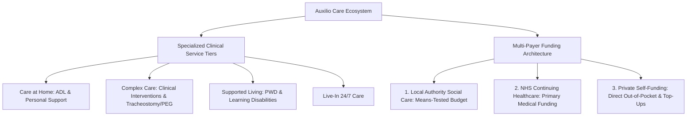

# Auxilio Care Model: Complex Care, Supported Living, & Multi-Payer Funding

> **Entity:** Auxilio Care Limited (United Kingdom - Solihull & West Midlands)  
> **URL:** [auxiliocare.com](https://www.auxiliocare.com/)  
> **Category:** Specialist Bespoke Domiciliary, Complex Needs, & Supported Living Provider  
> **Relevance to advanCARE:** Operational blueprint for managing complex disability care, persons with special needs (PWD), and blending public municipal subsidies with private out-of-pocket funding.

---

## 1. Overview & Service Scope

Auxilio Care is a CQC-regulated healthcare provider in the United Kingdom specializing in person-centered home care, supported living, and complex healthcare interventions.

Unlike general companion agencies, Auxilio focuses specifically on individuals with high-dependency, chronic, or specialized conditions:
- **Care at Home (Domiciliary):** Scheduled daily visits for personal care, nutrition, medication prompts, and domestic support.
- **Live-In Care:** 24/7 dedicated in-home support providing continuous companionship, monitoring, and safety.
- **Complex Care:** Clinical interventions for neurological disorders, tracheostomy/ventilator care, spinal cord injuries, PEG tube feeding, palliative care, and cerebral palsy.
- **Supported Living:** Housing and community inclusion support for adults with learning disabilities, autism spectrum conditions, and severe mental health challenges.

---

## 2. Multi-Payer Funding Architecture: Public-Private Blending

A critical operational breakthrough of the UK social care system exemplified by Auxilio Care is its flexible three-pathway funding structure:

### 1. Local Authority Social Care Funding (Means-Tested)
- The local municipal council (e.g., Solihull Metropolitan Borough Council) conducts a financial and needs assessment.
- If eligible, the council provides funding through:
  - **Managed Council Budget:** The municipality contracts and pays the provider directly on behalf of the resident.
  - **Direct Payments:** The client receives a cash budget directly into a managed account to independently contract approved care providers.

### 2. NHS Continuing Healthcare (CHC) (Non-Means-Tested)
- For individuals with complex, ongoing healthcare needs driven primarily by health conditions rather than social care.
- Fully funded by the National Health Service (NHS), with zero out-of-pocket cost to the patient or family.

### 3. Private Self-Funding & Council "Top-Ups"
- Individuals who exceed statutory financial thresholds self-fund their care directly.
- **Top-Up Mechanism:** Where council funding covers only baseline statutory hours, families can privately "top up" to purchase additional hours, specialized therapy, or transport.

---

## 3. Person-Centered Care Planning for Persons with Disabilities (PWD)

Auxilio Care structures care plans around the **"Whole Person"** rather than just a medical diagnosis:
- **Baseline Needs Assessment:** In-depth evaluation of communication methods, sensory triggers, mobility limits, and daily routines.
- **Consistent Carer Pairing:** Ensuring high caregiver continuity so vulnerable or neurodivergent clients are not unsettled by unfamiliar faces.
- **Community Inclusion:** Supporting participation in local social clubs, vocational activities, and life-skills development.

---

## 4. Strategic Takeaways for advanCARE

| Auxilio Care Operational Model | advanCARE Localization for Cagayan Grassroots |
| :--- | :--- |
| **Public-Private Blended Funding** | Direct inspiration for advanCARE’s **50% LGU Subsidy + 50% Household Out-of-Pocket** membership model (Platinum, Gold, Silver). |
| **Top-Up Flexibility** | If an LGU subsidizes scheduled visits, households or OFW sponsors can top up with ad-hoc **₱300/8hr Barangay Care** or **₱500/8hr CVMC Hospital Watchers**. |
| **Specialized PWD Care** | advanCARE integrates specific modules for Cagayan families caring for children/adults with special needs (cerebral palsy, intellectual disabilities). |
| **Statutory Alignment** | Auxilio aligns with NHS/Council assessments; advanCARE aligns with **DoH Yakap, PhilHealth, DSWD 4Ps, and Municipal Social Welfare and Development Office (MSWDO)** guidelines. |
| **Graceful Funding Degradation** | If municipal LGU funding lapses, clients smoothly transition to self-funded pay-per-visit without service termination. |
