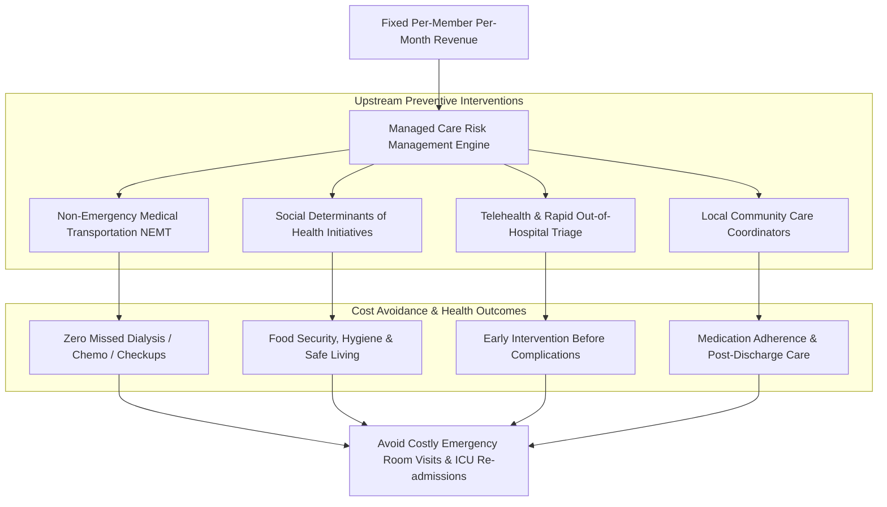

# Centene Corporation Model: Managed Care, NEMT, & Social Determinants of Health (SDOH)

> **Entity:** Centene Corporation (Fortune 500 - USA)  
> **URL:** [centene.com](https://www.centene.com/)  
> **Category:** Managed Care Organization (MCO), Capitation Financing, & Government Healthcare Delivery  
> **Relevance to advanCARE:** Operational blueprint for running a grassroots micro-managed care ecosystem, capitation economics (PMPM), integrating Non-Emergency Medical Transportation (NEMT), and solving Social Determinants of Health (SDOH).

---

## 1. Overview & Managed Care Capitation Economics

Centene Corporation is the largest Medicaid managed care organization in the United States, providing healthcare solutions to over 28 million members across Medicaid, Medicare Advantage (Wellcare), and Health Insurance Marketplaces (Ambetter).

### The Capitated PMPM Model
Unlike traditional fee-for-service systems where providers are incentivized by volume of sickness, Centene operates on **capitated risk management**:
- **Fixed Per-Member, Per-Month (PMPM):** State Medicaid programs pay a fixed fee per enrolled member per month, regardless of healthcare consumption.
- **Financial & Clinical Alignment:** The MCO bears full financial risk. Profitability and sustainability depend entirely on keeping members healthy, managing chronic diseases, and preventing high-cost catastrophic events (e.g., intensive care unit admissions, emergency room surges).
- **Proactive Upstream Intervention:** Investing small sums in preventative care, nutrition, medication adherence, and transportation saves tens of thousands of dollars in downstream hospital bills.

---

## 2. Non-Emergency Medical Transportation (NEMT) as a Clinical Safeguard

A cornerstone of Centene’s managed care model is treating **transportation as a non-negotiable medical benefit**:

### Why NEMT is Essential:
1. **The Transport Barrier:** In low-income and rural populations, missed appointments are overwhelmingly caused by lack of transportation, vehicle breakdowns, or unpayable transit costs.
2. **The Clinical Cascade:** A patient with end-stage renal disease who misses dialysis or a diabetic patient who misses insulin titration visits ends up in an emergency room within 48 to 72 hours with acute complications.
3. **The Financial Math:** A ₱500–₱1,000 NEMT trip saves ₱30,000–₱100,000 in emergency hospital bills.
4. **Operationalization:** Centene integrates automated NEMT dispatch platforms where rides are pre-scheduled based on appointment times, origin (rural home/sitio), destination (hospital/clinic), vehicle accessibility (wheelchair, stretcher, standard seat), and authorized escorts.

---

## 3. Social Determinants of Health (SDOH) & Local Community Delivery

Centene recognizes that clinical healthcare accounts for only ~20% of a person’s health outcomes; the remaining **80% is governed by Social Determinants of Health (SDOH)**:
- Physical environment & clean water.
- Transportation & geographic accessibility.
- Nutrition & food security ("Food is Medicine" programs).
- Social isolation & loneliness among the elderly.
- Economic stability and health literacy.

Centene executes this through a **decentralized, community-integrated strategy**: instead of operating as a remote monolith, it partners with localized Community-Based Organizations (CBOs), local health departments, and neighborhood clinics.

---

## 4. Strategic Takeaways for advanCARE

| Centene Managed Care Feature | advanCARE Localization for Cagayan Grassroots |
| :--- | :--- |
| **Capitated PMPM Revenue Model** | advanCARE structures its membership tiers (Platinum ₱350/mo, Gold ₱250/mo, Silver ₱150/mo) as predictable grassroots capitation, shared 50/50 with LGUs. |
| **NEMT Integration** | advanCARE implements a dedicated **Non-Emergency Medical Transport booking system** with fixed origin, destination, pickup time, and rural tricycle/van dispatch to CVMC. |
| **SDOH Integration** | advanCARE addresses transport barriers, elder isolation, and poverty by bundling healthcare coordination with youth livelihood and barangay BHW integration. |
| **Avoidable Hospitalization Reduction** | advanCARE targets the alarming **56.3% unattended mortality rate** in Cagayan by providing prompt teleconsults, home visits, and post-discharge follow-ups. |
| **PhilHealth Baseline Anchor** | Centene anchors plans to Medicaid; advanCARE anchors all tier pricing below the PhilHealth minimum floor (₱500/mo), proving superior cost-effectiveness to LGUs. |
