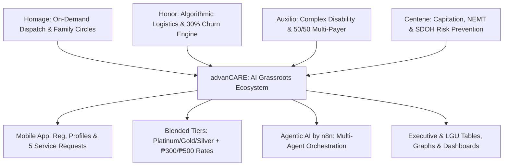

# Comparative Benchmark Matrix: Homage, Honor, Auxilio Care, & Centene vs. advanCARE

> **Synthesis Document:** Cross-Comparative Analysis of Global & Regional Care Pioneers  
> **Target Application:** Designing advanCARE as an AI-Enabled Grassroots Care Ecosystem in Cagayan Province, Philippines.

---

## 1. Executive Synthesis & Architectural Positioning

To build an enduring, financially self-sustaining healthcare platform for grassroots communities in Cagayan Province, advanCARE deliberately fuses the core operational and business breakthroughs of four global and regional leaders:

1. **Homage (Malaysia/Singapore):** *On-Demand Dispatch, Medical Escort, & Remote Family Care Notes.*
2. **Honor Technology (USA/Global):** *Centralized Logistics Platform, Multi-Dimensional Matching Algorithm, & High Caregiver Retention.*
3. **Auxilio Care (UK):** *Specialized Complex Care for PWD & Blended Public-Private (Local Authority + Out-of-Pocket) Funding.*
4. **Centene Corporation (USA):** *Capitated Risk Management (PMPM), NEMT as Clinical Risk Prevention, & SDOH Remediation.*

---

## 2. Comprehensive Comparative Matrix

| Strategic Dimension | **Homage** (MY/SG) | **Honor Technology** (US/Global) | **Auxilio Care** (UK) | **Centene Corporation** (US) | **advanCARE** (Cagayan Grassroots, PH) |
| :--- | :--- | :--- | :--- | :--- | :--- |
| **Primary Target Market** | Urban/suburban aging adults & post-acute patients | Broad senior demographic across US franchises (Home Instead) | Vulnerable adults, PWD, and complex clinical dependencies | Underserved, low-income Medicaid/Medicare beneficiaries | Aging farmers, fishers, PWD, and remote barangay households |
| **Primary Operating Model** | Tech-enabled on-demand home care & medical escort | Centralized cloud logistics platform + local franchise delivery | High-touch domiciliary, complex nursing & supported living | Government-sponsored Managed Care Organization (MCO) | Hybrid mobile-first platform + Barangay Health Worker (BHW) trust anchors |
| **Caregiver / Workforce Model** | Rigorously vetted independent Care Pros (<5% acceptance) | W-2/Employed Care Pros with app-based shift autonomy & 30% churn | Trained complex care support workers & registered nurses | Contracted healthcare networks & community care managers | Trained youth & barangay caregivers + CVMC hospital watchers |
| **Matching Mechanism** | Manual coordinator review + app-assisted availability tags | Proprietary AI & multidimensional matching algorithm | Needs-based clinical pairing by care coordinators | Risk stratification & provider network panel assignment | **Agentic AI (n8n)** matching proximity, sitio access, language, & skill badges |
| **Family Engagement** | Dual App: Daily care notes with photos, vitals & tasks | Honor Family App: Real-time GPS clock-in, daily notes & billing | Direct family consultations & care plan reviews | Member portals & designated care coordinator phone outreach | **Mobile App Family Profile** + automated SMS/Viber updates for OFW sponsors |
| **Transportation Strategy** | Medical Escort: Caregiver accompanies on rides/cabs | Incidental caregiver transport for errands/appointments | Organized transit for community social inclusion | **Formal NEMT Benefit:** Pre-scheduled medical transit to prevent ER visits | **Structured NEMT Module:** Fixed route scheduling (sitio to RHU/CVMC) with flat fees |
| **Revenue & Payer Model** | Out-of-pocket hourly (1hr+) or prepaid discount packages | Out-of-pocket private duty, long-term care insurance (LTCI) | Three pathways: Local Council, NHS CHC, or Private Self-Funding | Capitated Per-Member Per-Month (PMPM) government contracts | **Blended Capitation:** 50% LGU Subsidy + 50% Household (Platinum, Gold, Silver) |
| **Affordability Anchor** | Premium private-pay market rates | Commercial senior care pricing ($25–$40+/hr) | UK council tariff caps or NHS statutory rates | Government statutory Medicaid/Medicare benchmark | **Anchored below PhilHealth floor** (<₱500/mo total cost) |
| **Specialized Capabilities** | Stroke, dementia, Parkinson's, cancer, palliative care | Specialized Alzheimer’s & dementia memory support | Neurological, spinal, tracheostomy, PEG, autism support | Whole-person SDOH: food, housing, utility, addiction programs | Barangay-level home care (₱300/8hr) & CVMC hospital care (₱500/8hr) |

---

## 3. Key Insights & Synthesis for advanCARE

### Insight 1: The Logistics-First Mandate (From Honor)
Rural healthcare fails when scheduling is manual. By applying Honor’s algorithmic principles through **n8n automated workflows**, advanCARE eliminates manual dispatch delays and optimizes caregiver routes between adjacent sitios, directly honoring SLAs (Platinum 1hr city / 3hr rural).

### Insight 2: The Multi-Payer Cost Shield (From Auxilio Care)
Relying 100% on government grants causes fatal cash-flow cliffs when administrations change. Relying 100% on impoverished farmers and fishers causes churn. Auxilio Care’s public-private co-pay model validates advanCARE's **50% LGU Subsidy + 50% Household Out-of-Pocket** design. If an LGU exits, families drop to self-funded pay-per-visit without service collapse.

### Insight 3: NEMT is Preventative Medicine (From Centene)
In Cagayan, **56.3% of deaths in 2020 occurred without medical attendance**. Centene proved that transport is not a luxury; it is clinical risk management. By building an explicit **Non-Emergency Medical Transport (NEMT)** module connecting sitios to Cagayan Valley Medical Center (CVMC), advanCARE closes this life-or-death access gap.

### Insight 4: The Diaspora Peace-of-Mind Driver (From Homage)
Overseas Filipino Workers (OFWs) and Manila-based children frequently send money back to Cagayan but have zero visibility into their parents' actual health. Homage’s family care notes prove that **transparent digital reporting unlocks willingness-to-pay** from distant sponsors.
