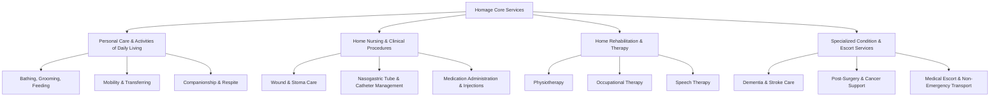
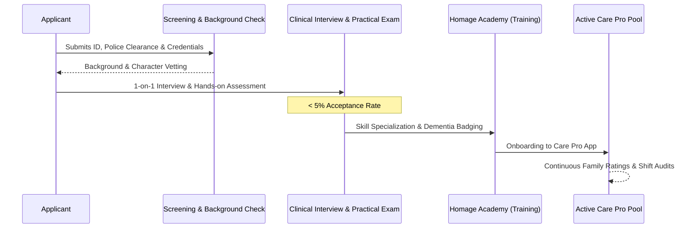

# Homage Model: On-Demand Care, Screening, & Holistic Care Matching

> **Entity:** Homage (Singapore, Malaysia, Australia)  
> **URL:** [homage.com.my](https://www.homage.com.my/)  
> **Category:** Tech-Enabled On-Demand Home Care & Telehealth Ecosystem  
> **Relevance to advanCARE:** Operational blueprint for on-demand caregiver dispatch, ADL support, medical escort, nursing procedures, and remote family visibility.

---

## 1. Overview & Core Value Proposition

Homage is a Southeast Asian healthtech company operating across Malaysia, Singapore, and Australia. It provides on-demand, personalized healthcare and caregiving services directly in the home, community, or clinical facility.

The core value proposition of Homage is **"Care Where You Are"**:
- Enabling seniors and individuals with chronic conditions or post-hospital recovery needs to age with dignity in their own homes.
- Eliminating long waiting times, logistical friction, and expensive institutional stays.
- Providing adult children and long-distance family members (including overseas workers / diaspora) with total transparency and peace of mind through a unified mobile application.

---

## 2. Service Architecture & Offerings

Homage structures its offerings into four distinct clinical and care tiers:

### A. Personal Care (ADLs)
- Assistance with bathing, grooming, dressing, toileting, diaper changing, feeding, and transfer.
- Respite care for primary family caregivers to prevent burnout.
- Vital signs monitoring (blood pressure, blood glucose, temperature, pulse oximetry).

### B. Home Nursing & Clinical Procedures
- Staffed by licensed, registered nurses.
- Complex procedures: IV therapy, wound dressings, tracheostomy care, catheter change/flushing, suctioning, and PEG/NG tube changes.
- Post-operative care avoiding extended hospital stays.

### C. Home Therapy (Rehabilitation)
- Home-based physical therapy (fall prevention, gait training, stroke motor recovery).
- Occupational therapy (home hazard assessment, assistive device training).
- Speech therapy (dysphagia / swallowing rehab, post-stroke aphasia).

### D. Medical Escort & Transport Accompaniment
- Care professionals meet the patient at home, coordinate transportation (cab/ambulance/private ride), accompany them to outpatient clinic appointments, take notes on doctor instructions, assist with pharmacy queueing, and bring the patient safely back home.

---

## 3. Caregiver Vetting, Quality Control & Training Pipeline

Homage differentiates itself through an extremely rigorous caregiver onboarding funnel:

1. **Selection Rate (<5%):** Only a small fraction of applicants are approved.
2. **Multi-Step Screening:** Identity verification, criminal history/police clearance, licensing verification (Malaysian Nursing Board, etc.), and professional reference checks.
3. **Homage Academy:** Structured modules covering dementia behavioral management, fall prevention, hygienic transfer techniques, and empathetic communication.
4. **Post-Visit Audits:** Every visit generates client feedback; ratings under 4.5 trigger internal clinical review and re-training.

---

## 4. Digital Platform & Mobile App Mechanics

Homage operates a two-sided digital platform supported by native mobile apps:

### 1. Client & Family App
- **Care Assessment & Booking:** Users specify patient condition, mobility score, language preferences, and required tasks.
- **Dynamic Matching:** Algorithmic recommendation of Care Professionals based on proximity, language, and clinical skill tags.
- **Visit Summary Reports (Care Notes):** At the end of every visit, the caregiver completes a digital checklist (meals consumed, vitals recorded, fluids, emotional state, activities completed) accompanied by photos, immediately visible to family members.
- **Integrated Payments:** Cashless checkout via credit card, e-wallets, or pre-paid multi-hour care packages (reducing hourly cost).
- **Long-Distance Care Coordination:** Multiple family members (e.g., child working in Kuala Lumpur or Singapore, parent residing in Ipoh) can join the same family care circle.

### 2. Care Pro App
- Shift discovery with clear payout breakdowns and location radiuses.
- Patient health summaries, allergies, care plans, and family notes before arrival.
- GPS clock-in / clock-out geofencing.
- Digital care log submission with structured vital sign inputs.

---

## 5. Strategic Takeaways for advanCARE

| Homage Operational Feature | How advanCARE Adapts for Cagayan Grassroots |
| :--- | :--- |
| **Medical Escort & Transport** | Direct inspiration for advanCARE's **Non-Emergency Medical Transport (NEMT)** request system connecting remote sitios to municipal clinics and CVMC. |
| **Digital Care Notes for Distant Family** | Critical feature for advanCARE's **OFW & City Family Sponsors**, allowing sons/daughters working abroad or in Manila to fund care and receive automated SMS/Viber summaries. |
| **Multi-Tier Skill Badging** | advanCARE assigns badges to Youth/Barangay Caregivers: Personal Care, Respite, Dementia/Chronic, and Hospital Watcher. |
| **No-Commitment Flexible Booking** | Retained in advanCARE's ad-hoc hourly rate alongside community monthly tiers. |
| **App-Driven Scheduling** | Adapted into low-bandwidth mobile app + SMS/WhatsApp fallback for sitios with unstable 4G/LTE. |
