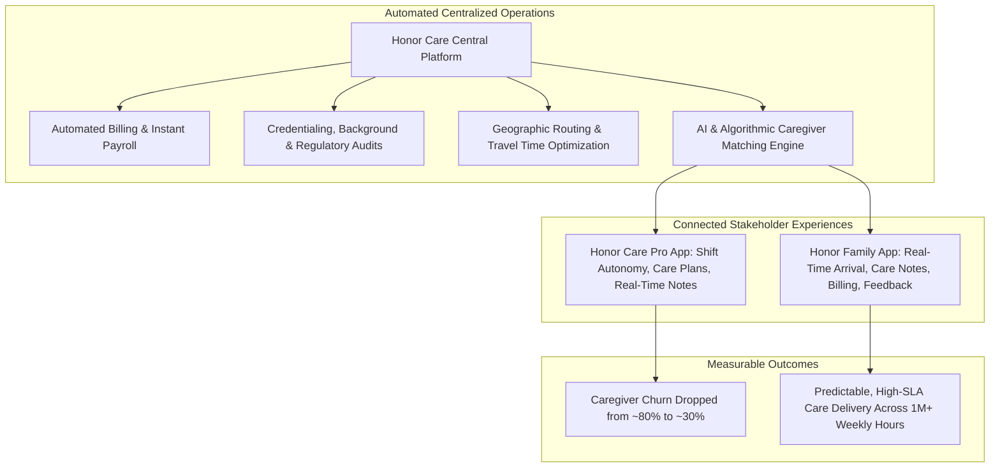

# Honor Technology Model: Platform Logistics, Algorithmic Matching, & Workforce Retention

> **Entity:** Honor Technology Inc. / Home Instead (Global / USA)  
> **URL:** [honorcare.com](https://www.honorcare.com/)  
> **Category:** Enterprise Healthtech Infrastructure & Scaled Senior Care Logistics  
> **Relevance to advanCARE:** Operational blueprint for centralized back-office scaling, predictive caregiver-patient matching algorithms, reducing caregiver churn, and family transparency.

---

## 1. Overview & Industry Problem Solved

Honor Technology is the world's largest senior care network, delivering over **1 million hours of care per week** following its acquisition of **Home Instead** in August 2021. 

Historically, the home care industry has been crippled by three systemic structural flaws:
1. **Extreme Caregiver Turnover:** Industry-wide annual churn frequently exceeds **75–80%**, caused by erratic hours, late scheduling, low pay, lack of professional respect, and administrative friction.
2. **Back-Office Inefficiency:** Independent agencies spend up to 70% of operational overhead on manual scheduling, billing disputes, regulatory compliance, and phone-based dispatch.
3. **Information Black Holes:** Families rarely receive timely updates on caregiver arrival, medication adherence, or daily condition changes.

Honor addressed this by creating the **Honor Care Platform**—a centralized technology, logistics, and data infrastructure layer that automates backend operations while empowering local operators and caregivers to deliver human-centered care.

---

## 2. The Algorithmic Matching Engine

Rather than relying on manual coordinator guesswork, Honor uses multi-dimensional algorithmic matching:

### Key Matching Dimensions:
1. **Acuity & Clinical Needs:** Matching specific patient requirements (e.g., Alzheimer’s wandering management, total bedbound transfer, stroke paresis) with validated caregiver competencies.
2. **Logistics & Proximity:** Calculating real-time transit times, route clustering, and geographic proximity to prevent caregiver burnout from excessive travel.
3. **Interpersonal & Cultural Compatibility:** Aligning language preferences, pet tolerance, household culture, and shared interests to foster long-term bonding.
4. **Historical Continuity & Satisfaction:** Prioritizing caregivers who have previously served the client and received high ratings, ensuring continuity of care.

---

## 3. Caregiver Workforce Retention: The "Care Pro" Philosophy

Honor fundamentally altered caregiver retention by treating care workers as respected healthcare professionals ("Care Pros"):

- **Scheduling Autonomy:** Care Pros specify when, where, and how much they want to work via the mobile app.
- **Fair, Transparent Compensation:** Instant visibility into hourly rates, overtime, travel compensation, and performance bonuses.
- **Clear Care Plans Before Arrival:** Care Pros review comprehensive client profiles, baseline vitals, emergency protocols, and household routines before stepping through the door.
- **Continuity Bonuses:** Financial and scheduling incentives for maintaining high repeat-shift rates with the same clients.
- **Results:** Caregiver turnover dropped from the **80% industry baseline down to ~30%**, creating a stable supply of trusted workers.

---

## 4. Dual-App Ecosystem & Real-Time Family Engagement

### 1. The Honor Family App
- **Live Visit Tracking:** Geofenced clock-in notifications notify families when the Care Pro arrives and departs.
- **Daily Digital Care Notes:** At shift conclusion, the Care Pro logs:
  - Mood and mental engagement.
  - Meal intake, hydration, and bathroom activity.
  - Medication reminders observed.
  - Any health anomalies or behavioral shifts.
- **Centralized Billing & Split-Payment:** Allows multiple siblings or remote family sponsors to split care invoices.

### 2. The Honor Care Pro App
- Shift marketplace with 1-tap claim or decline.
- Detailed task checklists per visit with mandatory completion checks.
- Direct secure in-app messaging to clinical support coordinators.
- Real-time incident reporting (e.g., falls, skin tears, agitation).

---

## 5. Strategic Takeaways for advanCARE

| Honor Mechanism | advanCARE Localization for Cagayan Grassroots |
| :--- | :--- |
| **Centralized Back-Office** | advanCARE uses **Agentic AI & n8n** to automate scheduling, dispatch, billing, and reporting, keeping administrative overhead near zero. |
| **Turnover Reduction Strategy** | Youth and barangay caregivers receive transparent pay (₱300/8hrs for Bgay, ₱500/8hrs for CVMC), skill badges, guaranteed shifts, and continuity bonuses. |
| **Smart Proximity Dispatch** | Algorithms cluster caregivers within the same barangay or adjacent sitios to eliminate costly rural travel times. |
| **Family Real-Time Visibility** | Long-distance family / OFW dashboard and SMS alerts provide peace of mind regarding parents in Cagayan. |
| **High-Tech / High-Touch Hybrid** | Honor’s franchise model mirrors advanCARE’s partnership with **Barangay Health Workers (BHWs)** and local rural health units. |
