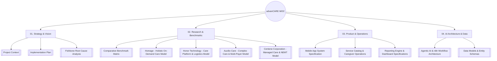

# advanCARE: Project Knowledge Vault & Master Map of Content (MOC)

> **Platform:** advanCARE — AI-Enabled Grassroots Healthcare Ecosystem  
> **Mission:** "No Farmer, Fisher, and Barangay Left Behind" — Cagayan Province, Philippines  
> **Vault Type:** Obsidian Operational & Conceptual Project Brain  
> **Visual Assets:** [[AdvanCare_Logo.png]] | [[Fishbone Diagram.jpeg]]

---

## 1. Quick Navigation & Vault Architecture

---

## 2. Core Vault Documents Index

### 01. Strategy, Vision & Root Cause Analysis
- **[[Project Context]]**: The foundational thesis, problem owner, baseline evidence (PSA 56.3% unattended mortality, 31.6% farmer poverty), financial self-sustainability, and structural revenue model.
- **[[Implementation Plan]]**: Phased rollout (Phase 0 validation to Phase 3 provincial scale), adoption hooks for farmers, youth, BHWs, and LGUs, risk mitigation, and financial viability.
- **[[Fishbone Root Cause Analysis]]**: Ishikawa 7-Spine decomposition mapped to [[Fishbone Diagram.jpeg]] and resolved via platform modules.

### 02. Research & International Benchmarks
- **[[Comparative Benchmark Matrix]]**: Multi-dimensional synthesis table comparing Homage, Honor, Auxilio Care, and Centene against advanCARE.
- **[[Homage - Holistic On-Demand Care Model]]**: Southeast Asian on-demand care pioneer; lessons on medical escort, strict caregiver vetting (<5%), and remote family care notes.
- **[[Honor Technology - Care Platform & Logistics Model]]**: World's largest senior care network (Home Instead); lessons on centralized back-office logistics, AI matching algorithms, and dropping caregiver churn from 80% to 30%.
- **[[Auxilio Care - Complex Care & Multi-Payer Model]]**: UK specialist in complex care & PWD; lessons on public-private co-pay blending (local authority social care + out-of-pocket top-ups).
- **[[Centene Corporation - Managed Care & NEMT Model]]**: Fortune 500 managed care giant; lessons on capitated PMPM financing, addressing Social Determinants of Health (SDOH), and treating Non-Emergency Medical Transport (NEMT) as clinical risk prevention.

### 03. Product Systems, Pricing, & Analytics
- **[[Mobile App System Specification]]**: Detailed functional specs for Client Registration & Subscriptions, Client Profile & Family Profile (with OFW sponsor linking), and the 5 service requests:
  1. *Tele-Consultation*
  2. *Request Medical Prescription*
  3. *Non-Emergency Medical Transport (NEMT)*
  4. *Home-Based Barangay Caregiver (₱300 / 8 hrs)*
  5. *CVMC Institutional Caregiver (₱500 / 8 hrs)*
- **[[Service Catalog & Caregiver Operations]]**: Unit economics (80% caregiver payout / 20% platform margin), caregiver vetting & badges (`BADGE_ADL`, `BADGE_DEMENTIA`, `BADGE_CVMC_WATCHER`), and Cagayan Valley Medical Center bedside watcher protocols.
- **[[Reporting Engine & Dashboard Specifications]]**: Real-time tabular ledgers, trend graphs, and role-based dashboards (Family/OFW, Municipal LGU, Executive Operations).
- **[[Admin Dashboard & Staff Accounts Plan]]**: Separate desktop `admin/` web app and Admin / Super Admin staff accounts for running operations (requests, caregiver assignment, payment reconciliation).

### 04. AI Systems, Workflows, & Data Infrastructure
- **[[Agentic AI & n8n Workflow Architecture]]**: Event-driven multi-agent orchestration in n8n (Triage Agent, Smart Matching Agent, Tele-Consult Routing Agent, Rx Logistics Agent, NEMT Logistics Agent, Care Note Summarizer Agent, and LGU Billing Agent).
- **[[Data Models & Entity Schemas]]**: Complete PostgreSQL schemas, PostGIS spatial queries, ERD, and webhook JSON contracts.

### 05. Design Handoff Package
- **[[START-HERE]]**: Entry point to the completed visual direction, 29 screen designs, shared components and logo.
- **[[IMPLEMENTATION-BRIEF]]**: Implementation brief for building the designed screens as real components and routes.
- **[[COMPONENTS]]**: Reusable component map taken from the Figma component tree.
- **[[FLOWS-AND-MOTION]]**: Screen flows and motion guidance.
- **[[IMPLEMENTATION-NOTES]]**: Business content differences to reconcile and remaining screens.
- **[[design-rationale]]**: "Refined care" visual direction and the reasoning behind it.
- Brain snapshots bundled with the handoff: [[project-project_context]], [[project-architecture]], [[project-decisions]].

---

## 3. Key Financial & Operational Anchors

- **PhilHealth Affordability Anchor:** Minimum statutory PhilHealth = ₱500/mo (₱6,000/yr). All advanCARE membership tiers are strictly cheaper:
  - **Platinum:** ₱4,200/yr (₱175/mo household OOP + ₱175/mo LGU subsidy)
  - **Gold:** ₱3,000/yr (₱125/mo household OOP + ₱125/mo LGU subsidy)
  - **Silver (4Ps / Indigent):** ₱1,800/yr (₱75/mo household OOP + ₱75/mo LGU subsidy)
- **Flat Service Shift Rates:**
  - **Barangay Home Caregiver:** ₱300 for 8 hours (₱240 net caregiver pay / ₱60 platform margin).
  - **CVMC Hospital Caregiver:** ₱500 for 8 hours (₱400 net caregiver pay / ₱100 platform margin).
- **Baseline Clinical Need:**
  - 56.3% of deaths in Cagayan in 2020 had no medical attendant (PSA).
  - advanCARE closes this gap through rapid tele-triage, NEMT transport, and hospital bedside watchers.
