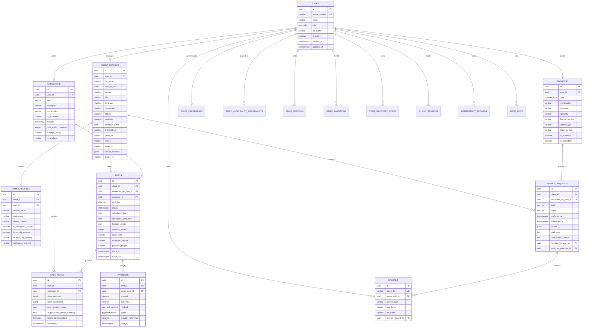

# advanCARE Data Models & Entity Schemas

> **Database:** Neon PostgreSQL 17 (via Cloudflare Hyperdrive; pilot coordinates use `latitude`/`longitude` `numeric(9, 6)` — PostGIS not yet enabled)  
> **ORM / Access Layer:** Drizzle ORM over `pg` (`backend/src/db/schema.ts`, migrations `0000`–`0007` in `backend/drizzle/`)  
> **System of Record & Integrity (ADR-006, ADR-007, ADR-011):**  
> - Every foreign key is `ON DELETE RESTRICT ON UPDATE RESTRICT` (no cascading deletes).  
> - Clinical fields (`client_profiles.clinical_baseline`, `care_notes.vitals_recorded`) and caregiver ratings (`caregivers.average_rating`) have **no defaults** and remain `NULL` until measured or recorded.  
> - Caregiver shift rates and 80/20 splits (₱300 → ₱240/₱60, ₱500 → ₱400/₱100 for 8 hours) are enforced by database `CHECK` constraints (ADR-002).  
> - `audit_logs` is enforced append-only via database triggers (`BEFORE UPDATE OR DELETE`, `BEFORE TRUNCATE`).

---

## 1. Entity-Relationship Diagram (ERD)



> **Note:** Subscription billing (`subscriptions`) and LGU subsidy reconciliation tables are planned for Staff Console Phase D and are not yet part of `backend/src/db/schema.ts`.

---

## 2. Core SQL Schema DDL (`backend/src/db/schema.ts` · Migrations `0000`–`0007`)

```sql
-- Enum Types (migrations 0000, 0001, 0005)
CREATE TYPE "public"."user_role" AS ENUM (
    'CLIENT',
    'FAMILY_SPONSOR',
    'CAREGIVER',
    'DOCTOR',
    'TRANSPORT_DRIVER',
    'BHW_PROXY',
    'COORDINATOR',
    'ADMIN',
    'SUPER_ADMIN'
);

CREATE TYPE "public"."provider_type" AS ENUM ('DOCTOR', 'TRANSPORT_DRIVER');
CREATE TYPE "public"."shift_tier" AS ENUM ('BGAY_HOME_300', 'CVMC_INSTITUTIONAL_500');
CREATE TYPE "public"."shift_status" AS ENUM (
    'REQUESTED',
    'MATCHING',
    'CONFIRMED',
    'IN_PROGRESS',
    'COMPLETED',
    'CANCELLED',
    'ESCALATED'
);
CREATE TYPE "public"."payment_method" AS ENUM ('GCASH', 'MAYA', 'CASH', 'BANK_TRANSFER');
CREATE TYPE "public"."payment_status" AS ENUM ('PENDING', 'SUCCEEDED', 'FAILED', 'REFUNDED');
CREATE TYPE "public"."staff_status" AS ENUM ('INVITED', 'ACTIVE', 'SUSPENDED');

-- 1. Users (migrations 0000, 0001, 0002, 0005, 0006)
CREATE TABLE "users" (
    "id" uuid PRIMARY KEY DEFAULT gen_random_uuid() NOT NULL,
    "phone_number" varchar(20),
    "email" varchar(255),
    "role" "user_role" DEFAULT 'CLIENT' NOT NULL,
    "full_name" varchar(255),
    "is_active" boolean DEFAULT true NOT NULL,
    "created_at" timestamp with time zone DEFAULT now() NOT NULL,
    "updated_at" timestamp with time zone DEFAULT now() NOT NULL,
    CONSTRAINT "users_phone_number_unique" UNIQUE ("phone_number"),
    CONSTRAINT "users_contact_required" CHECK ("users"."phone_number" IS NOT NULL OR "users"."email" IS NOT NULL)
);

CREATE UNIQUE INDEX "users_app_email_uq"
    ON "users" USING btree (lower("email"))
    WHERE "users"."email" IS NOT NULL
      AND "users"."role" IN ('CLIENT', 'FAMILY_SPONSOR', 'CAREGIVER', 'DOCTOR', 'TRANSPORT_DRIVER', 'BHW_PROXY', 'COORDINATOR');

-- 2. Client Profiles (migrations 0000, 0002)
-- ADR-007: clinical_baseline has NO default; NULL until recorded.
CREATE TABLE "client_profiles" (
    "id" uuid PRIMARY KEY DEFAULT gen_random_uuid() NOT NULL,
    "user_id" uuid NOT NULL REFERENCES "public"."users"("id") ON DELETE restrict ON UPDATE restrict,
    "full_name" varchar(255) NOT NULL,
    "date_of_birth" date,
    "gender" varchar(20),
    "sitio" varchar(100),
    "barangay" varchar(100) NOT NULL,
    "municipality" varchar(100) NOT NULL,
    "latitude" numeric(9, 6),
    "longitude" numeric(9, 6),
    "landmark_notes" text,
    "philhealth_id" varchar(50),
    "yakap_id" varchar(50),
    "pwd_id" varchar(50),
    "senior_id" varchar(50),
    "clinical_baseline" jsonb,
    "device_ref" varchar(64),
    "created_at" timestamp with time zone DEFAULT now() NOT NULL,
    "updated_at" timestamp with time zone DEFAULT now() NOT NULL
);

CREATE INDEX "client_profiles_user_id_idx" ON "client_profiles" USING btree ("user_id");
CREATE UNIQUE INDEX "client_profiles_user_device_ref_uq" ON "client_profiles" USING btree ("user_id", "device_ref");

-- 3. Family Profiles (migration 0000)
CREATE TABLE "family_profiles" (
    "id" uuid PRIMARY KEY DEFAULT gen_random_uuid() NOT NULL,
    "client_id" uuid NOT NULL REFERENCES "public"."client_profiles"("id") ON DELETE restrict ON UPDATE restrict,
    "user_id" uuid REFERENCES "public"."users"("id") ON DELETE restrict ON UPDATE restrict,
    "relative_name" varchar(255) NOT NULL,
    "relationship" varchar(50) NOT NULL,
    "phone_number" varchar(20) NOT NULL,
    "is_emergency_contact" boolean DEFAULT false NOT NULL,
    "is_remote_sponsor" boolean DEFAULT false NOT NULL,
    "location_city_country" varchar(150),
    "notification_channel" varchar(30) DEFAULT 'SMS' NOT NULL,
    "created_at" timestamp with time zone DEFAULT now() NOT NULL,
    "updated_at" timestamp with time zone DEFAULT now() NOT NULL
);

CREATE INDEX "family_profiles_client_id_idx" ON "family_profiles" USING btree ("client_id");

-- 4. Caregivers (migration 0000)
-- ADR-007: no default badges and average_rating is NULL until rated.
CREATE TABLE "caregivers" (
    "id" uuid PRIMARY KEY DEFAULT gen_random_uuid() NOT NULL,
    "user_id" uuid NOT NULL REFERENCES "public"."users"("id") ON DELETE restrict ON UPDATE restrict,
    "sitio" varchar(100),
    "barangay" varchar(100),
    "municipality" varchar(100),
    "is_accredited" boolean DEFAULT false NOT NULL,
    "badges" text[] DEFAULT ARRAY[]::text[] NOT NULL,
    "total_shifts_completed" integer DEFAULT 0 NOT NULL,
    "average_rating" numeric(3, 2),
    "is_available" boolean DEFAULT false NOT NULL,
    "created_at" timestamp with time zone DEFAULT now() NOT NULL,
    "updated_at" timestamp with time zone DEFAULT now() NOT NULL,
    CONSTRAINT "caregivers_user_id_unique" UNIQUE ("user_id"),
    CONSTRAINT "caregivers_average_rating_range" CHECK ("caregivers"."average_rating" IS NULL OR "caregivers"."average_rating" BETWEEN 1 AND 5),
    CONSTRAINT "caregivers_total_shifts_nonnegative" CHECK ("caregivers"."total_shifts_completed" >= 0)
);

-- 5. Providers: TeleHealth Doctors & Transport Drivers (migration 0005)
CREATE TABLE "providers" (
    "id" uuid PRIMARY KEY DEFAULT gen_random_uuid() NOT NULL,
    "user_id" uuid NOT NULL REFERENCES "public"."users"("id") ON DELETE restrict ON UPDATE restrict,
    "type" "provider_type" NOT NULL,
    "municipality" varchar(100) NOT NULL,
    "barangay" varchar(100),
    "specialty" varchar(120),
    "license_number" varchar(50),
    "vehicle_type" varchar(50),
    "plate_number" varchar(20),
    "is_available" boolean DEFAULT true NOT NULL,
    "is_accredited" boolean DEFAULT true NOT NULL,
    "created_at" timestamp with time zone DEFAULT now() NOT NULL,
    "updated_at" timestamp with time zone DEFAULT now() NOT NULL,
    CONSTRAINT "providers_user_id_unique" UNIQUE ("user_id")
);

CREATE INDEX "providers_type_municipality_idx" ON "providers" USING btree ("type", "municipality");
CREATE INDEX "providers_user_id_idx" ON "providers" USING btree ("user_id");

-- 6. Shifts & Care Delivery (migrations 0000, 0003)
-- ADR-002 & ADR-007: flat 8-hour rates and 80/20 split enforced by CHECK constraints.
CREATE TABLE "shifts" (
    "id" uuid PRIMARY KEY DEFAULT gen_random_uuid() NOT NULL,
    "client_id" uuid NOT NULL REFERENCES "public"."client_profiles"("id") ON DELETE restrict ON UPDATE restrict,
    "requested_by_user_id" uuid NOT NULL REFERENCES "public"."users"("id") ON DELETE restrict ON UPDATE restrict,
    "caregiver_id" uuid REFERENCES "public"."caregivers"("id") ON DELETE restrict ON UPDATE restrict,
    "shift_tier" "shift_tier" NOT NULL,
    "status" "shift_status" DEFAULT 'REQUESTED' NOT NULL,
    "scheduled_date" date NOT NULL,
    "scheduled_start_time" time NOT NULL,
    "location_details" text NOT NULL,
    "duration_hours" integer DEFAULT 8 NOT NULL,
    "gross_rate" numeric(10, 2) NOT NULL,
    "caregiver_payout" numeric(10, 2) NOT NULL,
    "platform_margin" numeric(10, 2) NOT NULL,
    "clock_in" timestamp with time zone,
    "clock_out" timestamp with time zone,
    "cancelled_at" timestamp with time zone,
    "cancellation_reason" text,
    "escalation_reason" text,
    "payout_paid_at" timestamp with time zone,
    "payout_reference" varchar(120),
    "payout_marked_by_user_id" uuid REFERENCES "public"."users"("id") ON DELETE restrict ON UPDATE restrict,
    "created_at" timestamp with time zone DEFAULT now() NOT NULL,
    "updated_at" timestamp with time zone DEFAULT now() NOT NULL,
    CONSTRAINT "shifts_duration_8h" CHECK ("shifts"."duration_hours" = 8),
    CONSTRAINT "shifts_rate_matches_tier" CHECK (
        ("shifts"."shift_tier" = 'BGAY_HOME_300' AND "shifts"."gross_rate" = 300 AND "shifts"."caregiver_payout" = 240 AND "shifts"."platform_margin" = 60)
        OR ("shifts"."shift_tier" = 'CVMC_INSTITUTIONAL_500' AND "shifts"."gross_rate" = 500 AND "shifts"."caregiver_payout" = 400 AND "shifts"."platform_margin" = 100)
    ),
    CONSTRAINT "shifts_clock_order" CHECK ("shifts"."clock_out" IS NULL OR ("shifts"."clock_in" IS NOT NULL AND "shifts"."clock_out" >= "shifts"."clock_in"))
);

CREATE INDEX "shifts_client_id_idx" ON "shifts" USING btree ("client_id");
CREATE INDEX "shifts_caregiver_id_idx" ON "shifts" USING btree ("caregiver_id");
CREATE INDEX "shifts_status_date_idx" ON "shifts" USING btree ("status", "scheduled_date");

-- 7. Care Notes (migration 0000)
-- ADR-007: vitals_recorded is nullable with NO default; unmeasured vitals are never defaulted.
CREATE TABLE "care_notes" (
    "id" uuid PRIMARY KEY DEFAULT gen_random_uuid() NOT NULL,
    "shift_id" uuid NOT NULL REFERENCES "public"."shifts"("id") ON DELETE restrict ON UPDATE restrict,
    "caregiver_id" uuid NOT NULL REFERENCES "public"."caregivers"("id") ON DELETE restrict ON UPDATE restrict,
    "vitals_recorded" jsonb,
    "tasks_completed" jsonb,
    "raw_caregiver_notes" text,
    "ai_generated_family_summary" text,
    "family_acknowledged" boolean DEFAULT false NOT NULL,
    "recorded_at" timestamp with time zone NOT NULL,
    "created_at" timestamp with time zone DEFAULT now() NOT NULL
);

CREATE INDEX "care_notes_shift_id_idx" ON "care_notes" USING btree ("shift_id");

-- 8. Payments (migration 0000)
CREATE TABLE "payments" (
    "id" uuid PRIMARY KEY DEFAULT gen_random_uuid() NOT NULL,
    "shift_id" uuid NOT NULL REFERENCES "public"."shifts"("id") ON DELETE restrict ON UPDATE restrict,
    "payer_user_id" uuid NOT NULL REFERENCES "public"."users"("id") ON DELETE restrict ON UPDATE restrict,
    "amount" numeric(10, 2) NOT NULL,
    "currency" varchar(3) DEFAULT 'PHP' NOT NULL,
    "method" "payment_method" NOT NULL,
    "status" "payment_status" DEFAULT 'PENDING' NOT NULL,
    "provider_reference" varchar(120),
    "paid_at" timestamp with time zone,
    "created_at" timestamp with time zone DEFAULT now() NOT NULL,
    "updated_at" timestamp with time zone DEFAULT now() NOT NULL,
    CONSTRAINT "payments_amount_positive" CHECK ("payments"."amount" > 0),
    CONSTRAINT "payments_currency_php" CHECK ("payments"."currency" = 'PHP')
);

CREATE INDEX "payments_shift_id_idx" ON "payments" USING btree ("shift_id");
CREATE UNIQUE INDEX "payments_method_provider_reference_uq" ON "payments" USING btree ("method", "provider_reference");

-- 9. Idempotency Records (migration 0000)
CREATE TABLE "idempotency_records" (
    "id" uuid PRIMARY KEY DEFAULT gen_random_uuid() NOT NULL,
    "idempotency_key" varchar(255) NOT NULL,
    "user_id" uuid REFERENCES "public"."users"("id") ON DELETE restrict ON UPDATE restrict,
    "request_method" varchar(10) NOT NULL,
    "request_path" varchar(255) NOT NULL,
    "request_hash" varchar(64) NOT NULL,
    "response_status" integer,
    "response_body" jsonb,
    "created_at" timestamp with time zone DEFAULT now() NOT NULL,
    "expires_at" timestamp with time zone NOT NULL
);

CREATE UNIQUE INDEX "idempotency_records_key_method_path_uq" ON "idempotency_records" USING btree ("idempotency_key", "request_method", "request_path");
CREATE INDEX "idempotency_records_expires_at_idx" ON "idempotency_records" USING btree ("expires_at");

-- 10. Staff Accounts & Append-Only Audit Log (migration 0001, ADR-011)
CREATE TABLE "staff_credentials" (
    "user_id" uuid PRIMARY KEY NOT NULL REFERENCES "public"."users"("id") ON DELETE restrict ON UPDATE restrict,
    "email" varchar(255) NOT NULL,
    "password_hash" text,
    "totp_secret_enc" text,
    "mfa_enabled" boolean DEFAULT false NOT NULL,
    "last_totp_step" integer,
    "status" "staff_status" DEFAULT 'INVITED' NOT NULL,
    "failed_attempts" integer DEFAULT 0 NOT NULL,
    "locked_until" timestamp with time zone,
    "created_by_user_id" uuid REFERENCES "public"."users"("id") ON DELETE restrict ON UPDATE restrict,
    "last_login_at" timestamp with time zone,
    "created_at" timestamp with time zone DEFAULT now() NOT NULL,
    "updated_at" timestamp with time zone DEFAULT now() NOT NULL,
    CONSTRAINT "staff_credentials_email_unique" UNIQUE ("email"),
    CONSTRAINT "staff_credentials_email_lowercase" CHECK ("staff_credentials"."email" = lower("staff_credentials"."email"))
);

CREATE TABLE "staff_municipality_assignments" (
    "id" uuid PRIMARY KEY DEFAULT gen_random_uuid() NOT NULL,
    "user_id" uuid NOT NULL REFERENCES "public"."users"("id") ON DELETE restrict ON UPDATE restrict,
    "municipality" varchar(100) NOT NULL,
    "assigned_by_user_id" uuid REFERENCES "public"."users"("id") ON DELETE restrict ON UPDATE restrict,
    "assigned_at" timestamp with time zone DEFAULT now() NOT NULL,
    "revoked_at" timestamp with time zone,
    "revoked_by_user_id" uuid REFERENCES "public"."users"("id") ON DELETE restrict ON UPDATE restrict
);

CREATE INDEX "staff_municipality_assignments_user_idx" ON "staff_municipality_assignments" USING btree ("user_id");
CREATE UNIQUE INDEX "staff_municipality_assignments_active_uq"
    ON "staff_municipality_assignments" USING btree ("user_id", "municipality")
    WHERE "staff_municipality_assignments"."revoked_at" IS NULL;

CREATE TABLE "staff_sessions" (
    "id" uuid PRIMARY KEY DEFAULT gen_random_uuid() NOT NULL,
    "user_id" uuid NOT NULL REFERENCES "public"."users"("id") ON DELETE restrict ON UPDATE restrict,
    "token_hash" varchar(64) NOT NULL,
    "created_at" timestamp with time zone DEFAULT now() NOT NULL,
    "last_seen_at" timestamp with time zone DEFAULT now() NOT NULL,
    "expires_at" timestamp with time zone NOT NULL,
    "revoked_at" timestamp with time zone,
    "ip" varchar(64),
    "user_agent" varchar(255),
    CONSTRAINT "staff_sessions_token_hash_unique" UNIQUE ("token_hash")
);

CREATE INDEX "staff_sessions_user_idx" ON "staff_sessions" USING btree ("user_id");

CREATE TABLE "staff_invitations" (
    "id" uuid PRIMARY KEY DEFAULT gen_random_uuid() NOT NULL,
    "user_id" uuid NOT NULL REFERENCES "public"."users"("id") ON DELETE restrict ON UPDATE restrict,
    "email" varchar(255) NOT NULL,
    "role" "user_role" NOT NULL,
    "municipalities" text[] DEFAULT ARRAY[]::text[] NOT NULL,
    "token_hash" varchar(64) NOT NULL,
    "invited_by_user_id" uuid REFERENCES "public"."users"("id") ON DELETE restrict ON UPDATE restrict,
    "approved_by_user_id" uuid REFERENCES "public"."users"("id") ON DELETE restrict ON UPDATE restrict,
    "expires_at" timestamp with time zone NOT NULL,
    "accepted_at" timestamp with time zone,
    "revoked_at" timestamp with time zone,
    "created_at" timestamp with time zone DEFAULT now() NOT NULL,
    CONSTRAINT "staff_invitations_token_hash_unique" UNIQUE ("token_hash"),
    CONSTRAINT "staff_invitations_staff_role" CHECK ("staff_invitations"."role"::text IN ('ADMIN', 'SUPER_ADMIN'))
);

CREATE INDEX "staff_invitations_user_idx" ON "staff_invitations" USING btree ("user_id");

CREATE TABLE "staff_recovery_codes" (
    "id" uuid PRIMARY KEY DEFAULT gen_random_uuid() NOT NULL,
    "user_id" uuid NOT NULL REFERENCES "public"."users"("id") ON DELETE restrict ON UPDATE restrict,
    "code_hash" varchar(64) NOT NULL,
    "used_at" timestamp with time zone,
    "created_at" timestamp with time zone DEFAULT now() NOT NULL
);

CREATE INDEX "staff_recovery_codes_user_idx" ON "staff_recovery_codes" USING btree ("user_id");

CREATE TABLE "audit_logs" (
    "id" uuid PRIMARY KEY DEFAULT gen_random_uuid() NOT NULL,
    "actor_user_id" uuid REFERENCES "public"."users"("id") ON DELETE restrict ON UPDATE restrict,
    "action" varchar(64) NOT NULL,
    "entity_type" varchar(40),
    "entity_id" varchar(64),
    "municipality" varchar(100),
    "metadata" jsonb,
    "ip" varchar(64),
    "request_id" varchar(128),
    "created_at" timestamp with time zone DEFAULT now() NOT NULL
);

CREATE INDEX "audit_logs_created_at_idx" ON "audit_logs" USING btree ("created_at");
CREATE INDEX "audit_logs_actor_idx" ON "audit_logs" USING btree ("actor_user_id", "created_at");
CREATE INDEX "audit_logs_entity_idx" ON "audit_logs" USING btree ("entity_type", "entity_id");

CREATE FUNCTION "public"."audit_logs_append_only"() RETURNS trigger LANGUAGE plpgsql AS $$
BEGIN
    RAISE EXCEPTION 'audit_logs is append-only (% blocked)', TG_OP USING ERRCODE = 'insufficient_privilege';
END;
$$;

CREATE TRIGGER "audit_logs_no_update_delete"
    BEFORE UPDATE OR DELETE ON "audit_logs"
    FOR EACH ROW EXECUTE FUNCTION "public"."audit_logs_append_only"();

CREATE TRIGGER "audit_logs_no_truncate"
    BEFORE TRUNCATE ON "audit_logs"
    FOR EACH STATEMENT EXECUTE FUNCTION "public"."audit_logs_append_only"();

-- 11. App Sign-in Codes & Sessions (migration 0002, ADR-014)
CREATE TABLE "client_login_codes" (
    "id" uuid PRIMARY KEY DEFAULT gen_random_uuid() NOT NULL,
    "email" varchar(255) NOT NULL,
    "code_hash" varchar(64) NOT NULL,
    "attempts" integer DEFAULT 0 NOT NULL,
    "expires_at" timestamp with time zone NOT NULL,
    "consumed_at" timestamp with time zone,
    "ip" varchar(64),
    "created_at" timestamp with time zone DEFAULT now() NOT NULL
);

CREATE INDEX "client_login_codes_email_idx" ON "client_login_codes" USING btree ("email", "created_at");

CREATE TABLE "client_sessions" (
    "id" uuid PRIMARY KEY DEFAULT gen_random_uuid() NOT NULL,
    "user_id" uuid NOT NULL REFERENCES "public"."users"("id") ON DELETE restrict ON UPDATE restrict,
    "token_hash" varchar(64) NOT NULL,
    "created_at" timestamp with time zone DEFAULT now() NOT NULL,
    "last_seen_at" timestamp with time zone DEFAULT now() NOT NULL,
    "expires_at" timestamp with time zone NOT NULL,
    "revoked_at" timestamp with time zone,
    "user_agent" varchar(255),
    CONSTRAINT "client_sessions_token_hash_unique" UNIQUE ("token_hash")
);

CREATE INDEX "client_sessions_user_idx" ON "client_sessions" USING btree ("user_id");

-- 12. Service Requests & Uploads (migrations 0004, 0005, 0007)
CREATE TABLE "service_requests" (
    "id" uuid PRIMARY KEY DEFAULT gen_random_uuid() NOT NULL,
    "client_id" uuid NOT NULL REFERENCES "public"."client_profiles"("id") ON DELETE restrict ON UPDATE restrict,
    "requested_by_user_id" uuid NOT NULL REFERENCES "public"."users"("id") ON DELETE restrict ON UPDATE restrict,
    "kind" varchar(20) NOT NULL,
    "status" varchar(20) DEFAULT 'SUBMITTED' NOT NULL,
    "preferred_at" timestamp with time zone,
    "scheduled_at" timestamp with time zone,
    "details" jsonb NOT NULL,
    "staff_note" text,
    "cancellation_reason" text,
    "handled_by_user_id" uuid REFERENCES "public"."users"("id") ON DELETE restrict ON UPDATE restrict,
    "assigned_provider_id" uuid REFERENCES "public"."providers"("id") ON DELETE restrict ON UPDATE restrict,
    "created_at" timestamp with time zone DEFAULT now() NOT NULL,
    "updated_at" timestamp with time zone DEFAULT now() NOT NULL,
    CONSTRAINT "service_requests_kind" CHECK ("service_requests"."kind" IN ('telehealth', 'rhu', 'triage', 'prescription', 'transport', 'supplies')),
    CONSTRAINT "service_requests_status" CHECK ("service_requests"."status" IN ('SUBMITTED', 'IN_REVIEW', 'SCHEDULED', 'COMPLETED', 'CANCELLED')),
    CONSTRAINT "service_requests_scheduled_has_time" CHECK ("service_requests"."status" <> 'SCHEDULED' OR "service_requests"."scheduled_at" IS NOT NULL)
);

CREATE INDEX "service_requests_client_idx" ON "service_requests" USING btree ("client_id");
CREATE INDEX "service_requests_status_created_idx" ON "service_requests" USING btree ("status", "created_at");
CREATE INDEX "service_requests_assigned_provider_idx" ON "service_requests" USING btree ("assigned_provider_id");

CREATE TABLE "uploads" (
    "id" uuid PRIMARY KEY DEFAULT gen_random_uuid() NOT NULL,
    "object_key" varchar(120) NOT NULL,
    "owner_user_id" uuid NOT NULL REFERENCES "public"."users"("id") ON DELETE restrict ON UPDATE restrict,
    "content_type" varchar(50) NOT NULL,
    "size_bytes" integer NOT NULL,
    "file_name" varchar(255),
    "service_request_id" uuid REFERENCES "public"."service_requests"("id") ON DELETE restrict ON UPDATE restrict,
    "created_at" timestamp with time zone DEFAULT now() NOT NULL,
    CONSTRAINT "uploads_object_key_unique" UNIQUE ("object_key")
);

CREATE INDEX "uploads_owner_idx" ON "uploads" USING btree ("owner_user_id");
CREATE INDEX "uploads_service_request_idx" ON "uploads" USING btree ("service_request_id");
```

---

## 3. API Request Payloads (Workers API Contracts — ADR-006)

All client write paths go through the Cloudflare Workers API (`/api/v1/*`) with an `Idempotency-Key` header (`idempotency_records`); n8n is reserved for asynchronous workflows only and never writes directly to PostgreSQL.

### Caregiver Shift Request (`POST /api/v1/shifts/request`)
Rates (`gross_rate`, `caregiver_payout`, `platform_margin`) and `duration_hours` (8) are set by the server from `shiftTier` per ADR-002.
```json
{
  "clientId": "7f8b9a20-8b43-4f51-b852-c28929e013a4",
  "shiftTier": "BGAY_HOME_300",
  "scheduledDate": "2026-11-20",
  "scheduledStartTime": "08:00",
  "locationDetails": "Purok 3, Brgy. Iraga, Solana (near the barangay chapel)"
}
```

### Other Service Requests (`POST /api/v1/service-requests`)
Covers `telehealth`, `rhu`, `triage`, `prescription`, `transport`, and `supplies`.
```json
{
  "kind": "supplies",
  "clientId": "7f8b9a20-8b43-4f51-b852-c28929e013a4",
  "summary": "2 items · est. ₱440 member price · Barangay pickup",
  "preferredAt": "2026-11-20T09:00:00.000Z",
  "details": {
    "items": [
      { "id": "amlodipine-5", "name": "Amlodipine 5 mg (generic)", "qty": 1, "memberPrice": 120, "rx": true },
      { "id": "adult-diapers", "name": "Adult diapers (M or L)", "qty": 1, "memberPrice": 280 }
    ],
    "fulfillment": "pickup",
    "shown": [
      "Items: Amlodipine 5 mg (generic) ×1, Adult diapers (M or L) ×1",
      "Estimated member total: ₱400 (20% member discount)",
      "Fulfillment: Pick up at barangay health center"
    ]
  },
  "uploadIds": ["3b9c4084-6497-4287-96d6-26785562e66a"]
}
```
